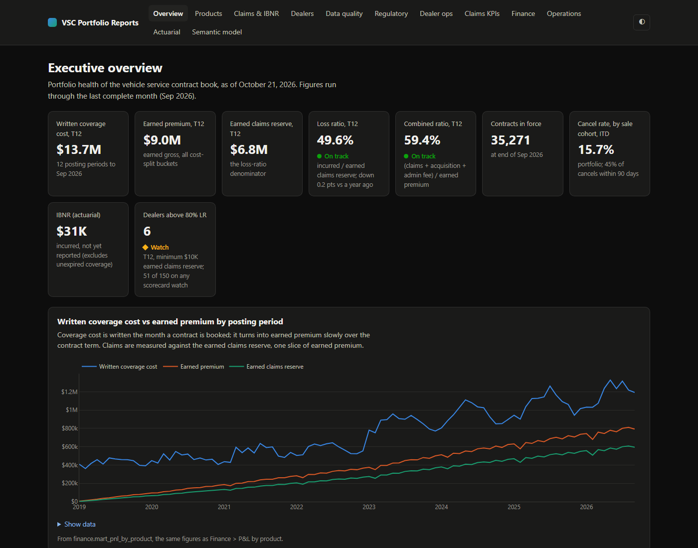
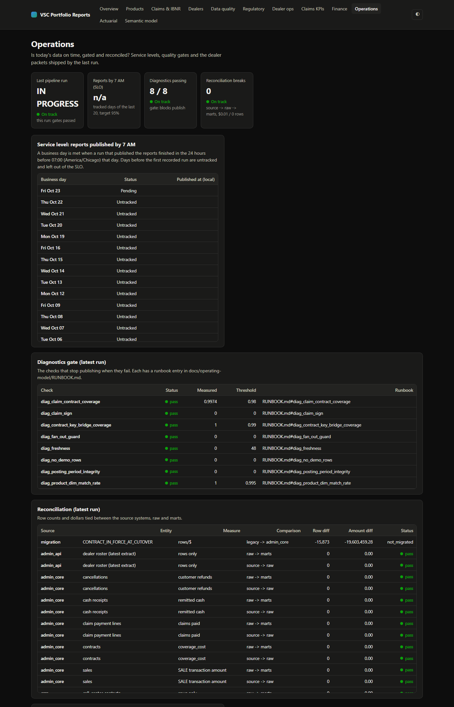
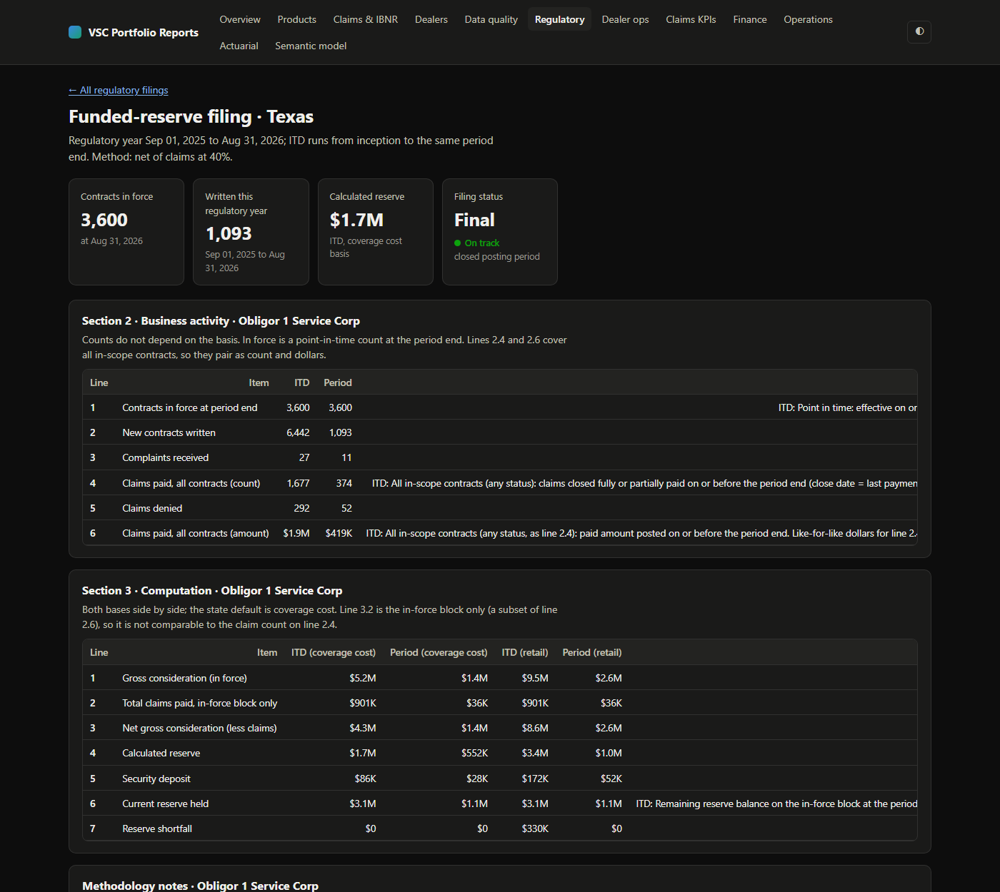
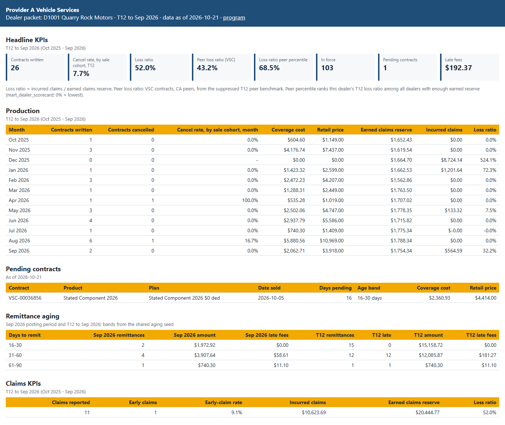
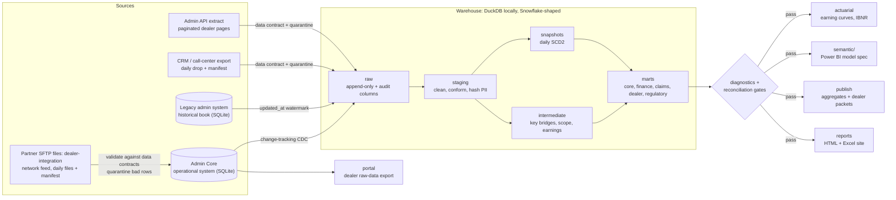

# Warranty Data Platform

**One person plus a team of AI agents can run the whole data department of a vehicle service contract (VSC)
administrator.** This repo is that department in a box: an operational admin system, a daily dealer feed, a
Snowflake-shaped warehouse, accounting-grade facts, a Power BI-ready semantic model, state regulatory filings,
dealer statements and per-dealer packets. All of it is rebuilt every day by one command, and it refuses to
publish a number that does not reconcile.

- **Reliable.** `python -m pipeline.run` rebuilds everything from an empty folder in about 3 minutes, on a laptop,
  with no Docker, no servers and no paid accounts. Each step fails fast, and every run is logged.
- **Reconciled.** Row counts and dollar totals are tied out from source to raw to marts on every run. Eight
  diagnostics gates **block publishing** when one breaks: product-dimension match rate, contract key-bridge
  coverage, claim-to-contract coverage, fan-out guard, claim sign, no demo rows, freshness and posting-period
  integrity (`diag_*` in [pipeline/diagnostics.py](pipeline/diagnostics.py)).
- **Secure.** PII is hashed or dropped at staging. The raw-data portal returns customer initials and masked
  VINs only (no e-mail, phone or ZIP); full contact data is an opt-in scope for a dealer's admin login, and every
  export is written to an access log. A dealer can only see its own rows, and a partner program only
  its own dealers, in the portal, in its packet and in the semantic model's row-level security, all driven by one
  user-to-dealer-and-tenant map.

> **All data is synthetic.** A seeded generator invents every dealer, contract, claim and customer. No real
> company's data, names, values or layouts are used. Company names in the data are generic ("Provider A",
> "Obligor 1", "Insurer North", "Summit Motors").

## See it without running it

The report site is build output (`site/` is not committed), so here are four of its pages from a real local run
on synthetic data. Run `python -m pipeline.run` and open `site/index.html` for the rest; CI also keeps the built
site as the `pipeline-output` artifact. `python tools/screenshots.py` re-takes these images after a run.

**Executive overview**: T12 premium, loss and combined ratio, in-force book, from the same P&L mart as Finance.



**Operations**: the 7 AM SLO, the eight diagnostics gates and the source-to-raw-to-mart reconciliation. The
first reconciliation row is the legacy in-force book that is not converted yet; it is a documented exclusion,
not a hidden break (item 1 on the [roadmap](docs/ROADMAP.md)).



**A state funded-reserve filing** with both bases side by side and a methodology-notes column, plus its Excel
workbook.



**A per-dealer packet**, filtered to one dealer and branded for its partner program.



## Legacy vs better

The usual way a VSC administrator's reporting grows up, and what this platform does instead. The longer version
is in [docs/LEGACY_VS_BETTER.md](docs/LEGACY_VS_BETTER.md).

| Typical legacy setup | This platform |
|---|---|
| Reports pulled straight from the admin system's database, then fixed by hand in Excel | Reports read tested marts only; raw and staging tables are never queried by a report |
| One giant BI model with hundreds of copy-pasted measures (MTD, QTD, YTD copies of each) | Four domain models generated from one `metrics.yml`, plus **one** time-intelligence calculation group |
| Counting rules ("which statuses count as in force?") hidden in spreadsheet comments | Counting rules are seed tables with tests ([report definitions](dbt/seeds/regulatory/)) |
| Inner joins to a stale product table silently drop new contracts | Left joins plus a match-rate gate by entered year; the run stops below 99.5% |
| Contract facts at transaction grain, so joins fan out and double-count | A fan-out guard on every contract-grain model: rows must equal distinct contracts |
| Claim amounts stored negative in one source, positive in another | Signs conformed once in staging, with a test on both sides |
| Demo and test dealers filtered in every query (or forgotten) | Excluded once, in `int_reportable_scope`, and checked by a gate |
| Status history starts the day someone first saved a snapshot | Daily SCD2 snapshots from day one, plus a history backfill |
| Hand-built Excel exports emailed to each dealer | Per-dealer packets and a raw-data portal, both scoped by the same access map |
| "Does this match the source?" answered after a complaint | Source-to-mart reconciliation on every run, stored in `audit.reconciliation` |

## How we got here

The platform tells the whole history of a VSC administrator's reporting, not just the end state
([details](docs/LEGACY_VS_BETTER.md)):

| Stage | What it was | What this repo does about it |
|---|---|---|
| 1. App-database reporting | Views and CSV exports straight from the admin app; no history | The legacy admin system is kept as a source; CDC and daily SCD2 snapshots give history from day one |
| 2. BI over the operational database | One giant model, copied MTD/QTD/YTD measures | Four domain models generated from `metrics.yml`, one calculation group |
| 3. Partner feeds and white-label programs | Daily dealer files, partner programs needing their own branding and scope | Data contracts, quarantine, and per-partner-program (tenant) scoping everywhere |
| 4. Warehouse migration | Move to an orchestrated, layered warehouse | Legacy book (before the 2023-01-01 cutover) and Admin Core load side by side, tied out by reconciliation |

## Scoping and environments

A **tenant** is a white-label partner program (here `LKS`, `NGT` and `PVA`). Every view of the data is scoped
twice, by partner program and by dealer, from one user-to-dealer-and-tenant map: the raw-data portal
(`--tenant T --dealer D`), the per-dealer packets in `site/dealers/<tenant>/<dealer>/` (each branded for its
program), the semantic model's RLS roles (Tenant Partner, Dealer User) and the Postgres and Snowflake row
access policies.

**Dev, UAT and prod run locally.** `python -m pipeline.run --env dev|uat|prod` ([pipeline/envs.py](pipeline/envs.py))
points every path at one environment, so a UAT build never touches prod output:

| Env | Warehouse | dbt target | Sources, site, publish, run logs |
|---|---|---|---|
| prod (default) | `data/warehouse/warehouse.duckdb` | `dbt/target` | `data/source`, `data/landing`, `site`, `data/publish`, `data/runs` |
| uat | `data/env/uat/warehouse.duckdb` | `dbt/target_uat` | `data/env/uat/...` |
| dev | `data/env/dev/warehouse.duckdb` | `dbt/target_dev` | `data/env/dev/...` |

UAT and dev start from a one-time copy of the prod sources (the local stand-in for a zero-copy clone).
Before promotion, [tools/env_diff.py](tools/env_diff.py) compares every mart table's row count and money totals
in UAT with prod; a difference passes only if the change ticket's `--expect` CSV explains it
([RELEASE](docs/operating-model/RELEASE.md)). On a server the same three tiers are the dbt targets in
[dbt/profiles.yml](dbt/profiles.yml) (`SNOWFLAKE_DATABASE` = `ANALYTICS_DEV`, `ANALYTICS_UAT` or `ANALYTICS`)
and the zero-copy clones in
[warehouse/snowflake/07_environments_clone.sql](warehouse/snowflake/07_environments_clone.sql) (written, not
executed here); the BI workspaces per environment are in [ACCESS_MATRIX](docs/ACCESS_MATRIX.md).

## Quickstart

Python 3.12+ (tested on 3.13).

**Windows PowerShell**

```powershell
python -m venv .venv
.venv\Scripts\python.exe -m pip install -r requirements.txt
.venv\Scripts\python.exe -m pipeline.run                # full run from nothing, about 3 minutes
.venv\Scripts\python.exe -m pipeline.run --append-day   # next business day: CDC loads only new versions
start site\index.html
```

`tasks.ps1` wraps the same commands: `.\tasks.ps1 setup | lint | test | run | day | dbt | docs | clean`.
`.\tasks.ps1 demo` (`make demo`) fills the operations page's run history: a build, three daily runs, and one
injected reconciliation-gate failure (a late source batch after the extract) with its recovery run
([tools/demo_history.py](tools/demo_history.py), `--dry-run` prints the plan). `.\tasks.ps1 schedule` registers a
weekday 06:00 `day` run, so the 7 AM SLO table builds up real day-by-day history.

**bash (macOS / Linux / Git Bash)**

```bash
python3 -m venv .venv
.venv/bin/python -m pip install -r requirements.txt
.venv/bin/python -m pipeline.run
open site/index.html   # or xdg-open
```

Useful flags: `--from dbt` resumes from a step, `--only publish reports` runs a subset (it is refused if a gate
failed), and `--seed 7` builds a different synthetic world. Each run writes a JSON summary to `data/runs/` and a
row to `audit.pipeline_run`.

**Try a change in UAT, then promote it**

```powershell
.venv\Scripts\python.exe -m pipeline.run --env uat                          # build into data/env/uat (prod untouched)
.venv\Scripts\python.exe tools\env_diff.py --expect <ticket>_expected_diffs.csv  # UAT vs prod; exit 1 on an unexplained diff
# promote: merge the change; the next prod run (no --env) rebuilds prod from source
```

The diff's latest result is saved to `data/env/env_diff.json`, and the Operations page shows it once a check has
run (a fresh build has none yet; see the [roadmap](docs/ROADMAP.md)). Sample output is in
[RELEASE](docs/operating-model/RELEASE.md#sample-promotion-check).

Other entry points:

```powershell
.venv\Scripts\python.exe -m portal export --tenant PVA --dealer D1001   # one dealer's raw data, nobody else's
.venv\Scripts\python.exe -m portal serve                               # the same, as a small read-only HTTP API
.venv\Scripts\python.exe -m semantic --check                           # semantic model is in sync with metrics.yml
.venv\Scripts\python.exe -m pytest -q; .venv\Scripts\python.exe -m ruff check .
```

## Architecture



The ten pipeline steps run in order as separate processes: generate, feed, ingest, dbt, diagnostics, reconcile,
actuarial, semantic, publish, reports. Steps after the gates never run when a gate fails.

| Layer | Runs locally | Production shape (written, not executed here) |
|---|---|---|
| Operational source | Admin Core and legacy system in SQLite | SQL Server with change tracking |
| Intake | Daily dealer-feed landing folder with manifest checksums; CRM call-center export and paginated admin API extract, each with a data contract and quarantine. CRM contacts feed `core.fct_call_center_contact` and claim contact rates; the admin-API roster is checked against `dim_dealer` by a reconciliation gate test; both are tied out in `audit.reconciliation` | Partner SFTP, CRM exports and admin API pulls |
| Warehouse | DuckDB, one schema per layer | Snowflake `RAW` / `ANALYTICS` databases, see [warehouse/snowflake/](warehouse/snowflake/) |
| Transform | dbt Core (140+ models, 4 snapshots, 15 seeds, 440+ data tests; counts from `dbt/target/manifest.json`) | the same project on the dbt `snowflake` target |
| Orchestration | `python -m pipeline.run` | Airflow DAG calling the same steps ([pipeline/airflow/](pipeline/airflow/)) |
| BI | Static HTML + Excel site, TMDL model spec | Power BI semantic models with dynamic RLS |

Details: [ARCHITECTURE](docs/ARCHITECTURE.md), [DATA_MODEL](docs/DATA_MODEL.md), [METRICS](docs/METRICS.md),
[V3 design contract](docs/V3_DESIGN.md), [RUNBOOK](docs/operating-model/RUNBOOK.md).

## What it builds

- **Admin Core**, a generic multi-tenant admin system with 13 modules: rating, contracts, dealers and agents,
  remittance (entered, sent, received), dealer-cost disbursements, cancellations and reinstatements, amendments,
  claims with payment lines, participation entities, commissions and white-label administrator branding.
- **Accounting-grade facts.** Every financial fact carries a posting-period key, so a late event never restates
  a closed month. There is one claims fact, at payment-line grain, and every claims roll-up comes from it.
- **Reports** ([docs/REPORTS.md](docs/REPORTS.md)): state funded-reserve filings and market surveys (Excel and
  HTML, with a methodology-notes column), dealer production and pending contracts, remittance aging with late
  fees, surcharge audit, specialty line, claims KPIs, cession and experience, profit-share statement, commission
  statement, P&L by product, actuarial reserves, and an operations page with run history.
- **Semantic layer** ([semantic/](semantic/)): Sales, Claims, Finance and Compliance models, generated from
  [dbt/models/metrics.yml](dbt/models/metrics.yml). A test proves every measure maps to a metric.
- **Operating model** ([docs/operating-model/](docs/operating-model/)): SLAs, runbook, incident template, an
  example postmortem, intake form, release process and data dictionary. Access is set out in
  [ACCESS_MATRIX](docs/ACCESS_MATRIX.md).

## The team of agents

The platform was built by AI agents, each playing one role on a real data department's org chart. Each role owns
its files (see section 3 of the [design contract](docs/V3_DESIGN.md)), works on its own warehouse copy, and
reports back what it built, how it checked it, and what is still open.

| Title | Owns |
|---|---|
| **Senior Director** | Final sign-off, this README, the legacy-vs-better story, the brand-scrub check |
| **Director** | Architecture and the binding design contract, data model, integration of every area |
| **Reporting Manager** | The report site shell, report docs, the operating-model docs |
| **Senior Data Analyst (regulatory)** | Funded-reserve filings, market surveys, counting-rule seeds |
| **Senior Data Analyst (dealer & claims)** | Dealer production, pending contracts, surcharge audit, specialty line, claims KPIs |
| **Senior Power BI Specialist** | `metrics.yml`, the semantic model generator, RLS roles, the calculation group |
| **Financial Analyst II** | Profit share, cession and experience, P&L by product, finance controls |
| **Financial Analyst I** | Remittance aging, commission statements, cash tie-outs |
| **Data Engineering Manager** | dbt project layout, diagnostics and reconciliation gates, publish, Snowflake scripts |
| **Data Engineer** | Generator, Admin Core, dealer feed and data contracts, CDC ingest, portal |
| **Data Scientist** | Actuarial module: earning curves, loss triangles, IBNR, early-claim emergence |
| **Data Engineer / Data Scientist** | The bridge between ingest and modeling: snapshots, history backfill, forecast back-tests |

## Checks

| Check | Command |
|---|---|
| Full run, gates included | `python -m pipeline.run` |
| Python tests (300+ pytest tests, including injected gate failures) | `python -m pytest -q` |
| Lint | `python -m ruff check .` |
| Semantic model in sync | `python -m semantic --check` |
| Brand scrub (needs the private term list) | `python tools/brand_scrub.py` |

## Known limitations

The full ranked list, with value, risk, effort and owner for each item, is in [docs/ROADMAP.md](docs/ROADMAP.md).
The top items:

1. **The legacy in-force book is not migrated.** 15,873 contracts in force at the 2023-01-01 cutover
   ($19.6M coverage cost) stay on the legacy system of record. Reconciliation reports them as `not_migrated`, a
   documented exclusion, so "Reconciliation breaks 0" does not include them.
2. **No SLO history yet.** The 7 AM SLO has no tracked days until scheduled daily runs build it up
   (`.\tasks.ps1 demo` fills a demo history; `.\tasks.ps1 schedule` starts the real one).
3. **No live UAT-to-prod promotion check yet.** `tools/env_diff.py` works, but no `data/env/env_diff.json` exists
   until a UAT build is diffed against prod.
4. **Two definitions still to merge**: remittance late fees (dealer vs finance marts) and the combined ratio
   ([METRICS](docs/METRICS.md#open-governance-items)).
5. Several V1 pages still read the retired `gold` / `silver` schema names through compatibility views.
6. The Snowflake scripts, the dbt `snowflake` target, the Postgres RLS policies and the Airflow DAG are written
   but not executed here. Running them needs accounts or Docker.
7. Reports and publish are the slowest steps (about half of the run).

## Author

Built by **Michael Hanson** ([GitHub](https://github.com/MichaelH117) · [LinkedIn](https://linkedin.com/in/michaelhanson117)).
He designed the platform and directed a team of AI agents (Claude Code), each working in a data-department role,
then reviewed and verified the results. All data is synthetic. Licensed under the [MIT License](LICENSE).
