<p align="center">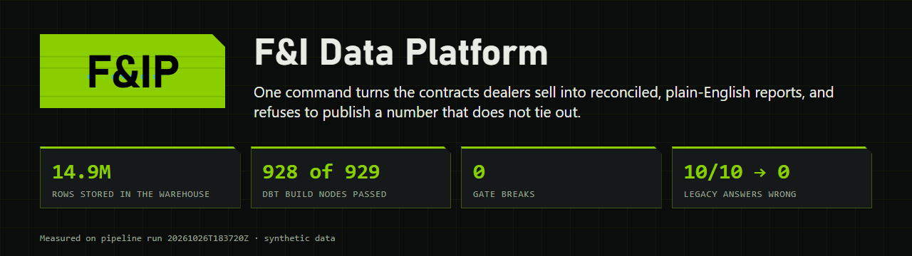</p>

# F&IP

**F&I Data Platform. One command turns the contracts dealers sell into reconciled, plain-English reports, and
refuses to publish a number that does not tie out.**

<!-- badges:start -->
[](https://github.com/MichaelH117/fi-data-platform/actions/workflows/ci.yml)
[](#checks)
[](#checks)
[](#quickstart)
[](#real-power-bi-on-a-real-database)
[](powerbi/README.md)
[](LICENSE)
<!-- badges:end -->

## Results at a glance

<!-- results:start -->
| Result | Value | What is behind it |
|---|---|---|
| Rows stored in the warehouse | **14.9M** | 14,954,790 rows in 166 DuckDB tables and snapshots, all layers (11,320,528 in the marts reports read); 59 views not counted |
| dbt build nodes passed | **928 of 929** | pipeline build: 175 models, 4 snapshots, 26 seeds, 722 data tests, 2 unit tests; 0 failed; 1 known data-quality warning (warn_rv_missing_chassis_vin, 30 rows); 11 of 11 gate tests after |
| Python tests passed | **779** | 0 failed, 2 skipped of 781 run; 2 slow end-to-end tests not in this record; recorded 2026-10-26 |
| Full rebuild time | **9 min 54 s** | 10 of 10 steps ok, source data to published site, one command (594.67 s) |
| Gate breaks | **0** | 16 of 16 diagnostics passed; 36 of 37 reconciliation checks tied out, 1 documented waiver; 3 of 3 publish gates ok |
| Legacy answers wrong | **10/10 → 0** | old warehouse wrong or failed on 10 of 10 business questions; new platform: 0 errors or timeouts |
| Slow legacy query | **961.9 ms → 44.6 ms** | Q07 (Attributes for a provider-scoped population), the benchmark's slow query, legacy vs new, same server and rows; legacy Q10 timed out at 60 s (new: 32.2 ms) |
| Dealer packets | **150** | one packet per reportable dealer, filtered to that dealer's rows only |

Read from pipeline run `20261026T183720Z` (finished 2026-10-26 18:47 UTC), its dbt results and audit tables, the pytest record of 2026-10-26 and the legacy benchmark of 2026-10-26, by `python -m reports` ([docs/showcase_stats.json](docs/showcase_stats.json)). Short values are truncated, never rounded up. Synthetic data.
<!-- results:end -->

**[Read the one-page case study](docs/CASE_STUDY.md)** ([print/PDF](docs/case_study.pdf)): the problem, what was
built, the measured results and how it would run at a real company.

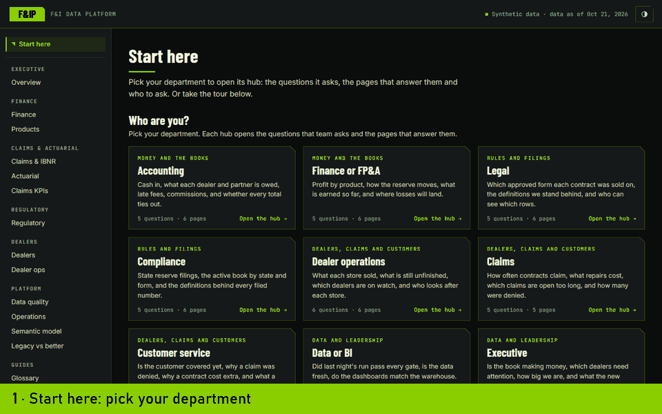

**What it is.** The reporting platform of an F&I (finance and insurance) product administrator: it takes the
contracts dealers sell in the finance office (vehicle service contracts, GAP, ancillary protection and prepaid
maintenance), checks them, and turns them into the reports dealers, finance, compliance and executives use: an
operational admin system, a daily dealer feed, a Snowflake-shaped warehouse, accounting-grade facts, a Power
BI-ready semantic model, state reserve filings, dealer statements and per-dealer packets. Every tile and chart
on the site explains itself in three plain-English lines.

**Measured against a rebuilt legacy warehouse** (same synthetic rows, same server; details in
[Legacy vs better](#how-it-was-and-how-we-fixed-it)): on ten everyday business questions the legacy side
got all ten wrong, slow or only half done. It lost 50.7% of one dealer's in-force book to duplicate dealer ids,
dropped 9,614 of 59,985 contracts through a stale product table, reported paid claims as -$18,883 instead of
$6,187,027, and timed out at 60 seconds on a vehicle lookup the modern key join answers in 32 ms.

- **Reliable.** `python -m pipeline.run` rebuilds everything from an empty folder in about 10 minutes, on a laptop,
  with no Docker, no servers and no paid accounts. Each step fails fast, and every run is logged.
- **Reconciled.** Row counts and dollar totals are tied out from source to raw to marts on every run. Sixteen
  diagnostics gates **block publishing** when one breaks: product-dimension match rate, contract key-bridge
  coverage, claim-to-contract coverage, fan-out guard, claim sign, no demo rows, freshness, posting-period
  integrity, form-code coverage, the co-buyer feed join, cancel reversals, parent-contract links, agent of
  record, the custom-field layer gap, unassigned commission and filing-entity true zeros (`diag_*` in
  [pipeline/diagnostics.py](pipeline/diagnostics.py)).
- **Secure.** PII is hashed or dropped at staging. The raw-data portal returns customer initials and masked
  VINs only (no e-mail, phone or ZIP); full contact data is an opt-in scope for a dealer's admin login, and every
  export is written to an access log. A dealer can only see its own rows, and a partner program only
  its own dealers, in the portal, in its packet and in the semantic model's row-level security, all driven by one
  user-to-dealer-and-tenant map.

> **All data is synthetic.** A seeded generator invents every dealer, contract, claim and customer. No real
> company's data, names, values or layouts are used. Company names in the data are generic ("Provider A",
> "Obligor 1", "Insurer North", "Summit Motors").

## See it without running it

Six pages of the report site from a real local run on synthetic data (`site/` is build output, not committed).
Run `python -m pipeline.run` and open `site/start.html`; CI also keeps the built site as the `pipeline-output`
artifact. `python tools/screenshots.py` re-takes these images after a run.

| | |
|---|---|
| 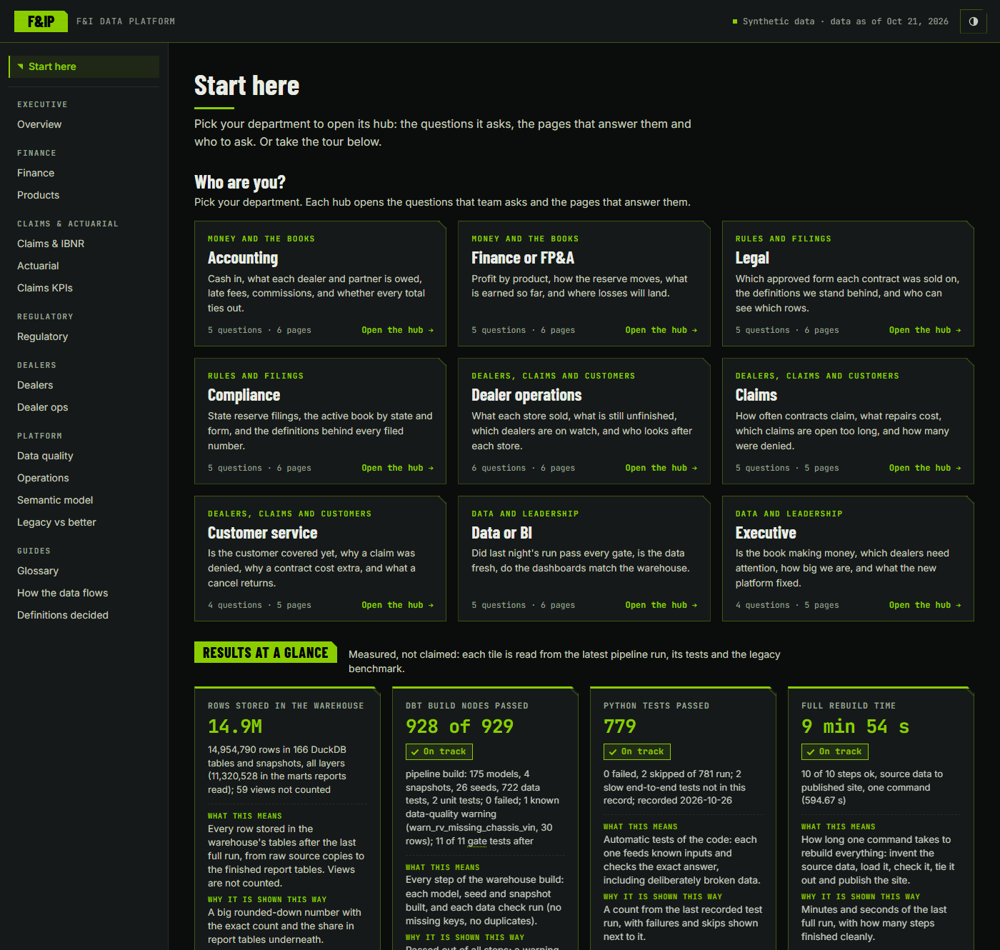 | 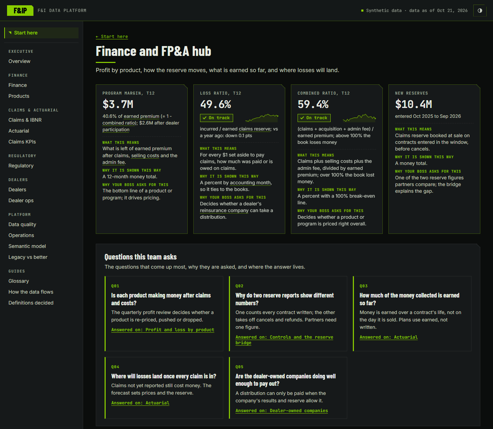 |
| **Start here.** Pick one of nine department hubs; the measured results sit underneath. | **A department hub.** Its numbers, the questions that team asks, the pages that answer them and who to ask when a number looks wrong. |
| 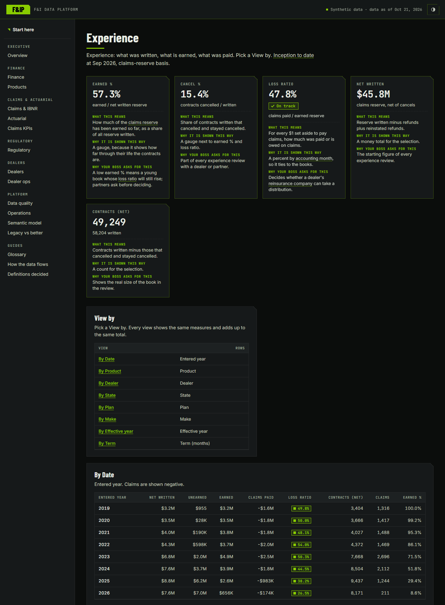 | 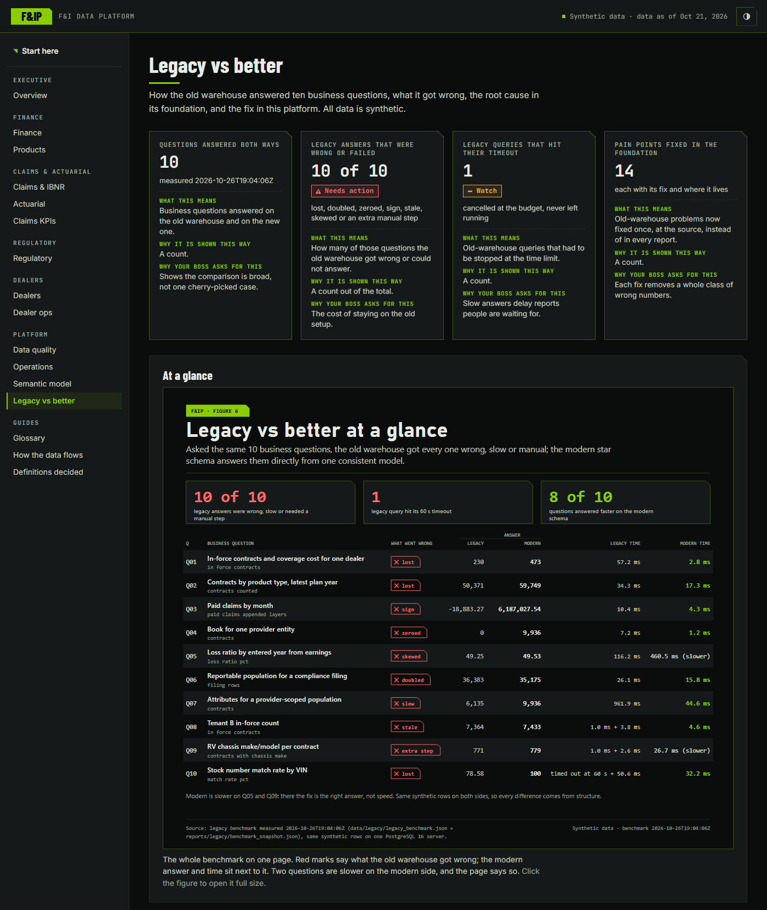 |
| **Experience.** What was written, earned and paid, cut by date, product, dealer or state, with an Excel copy. | **Legacy vs better.** The same ten questions on the old warehouse and the new one, wrong answers marked. |
| 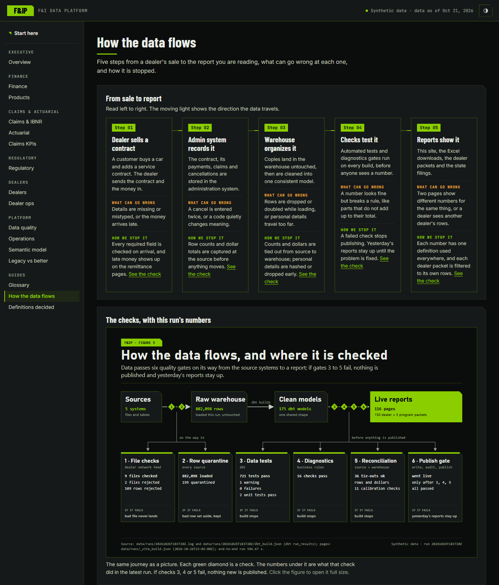 | 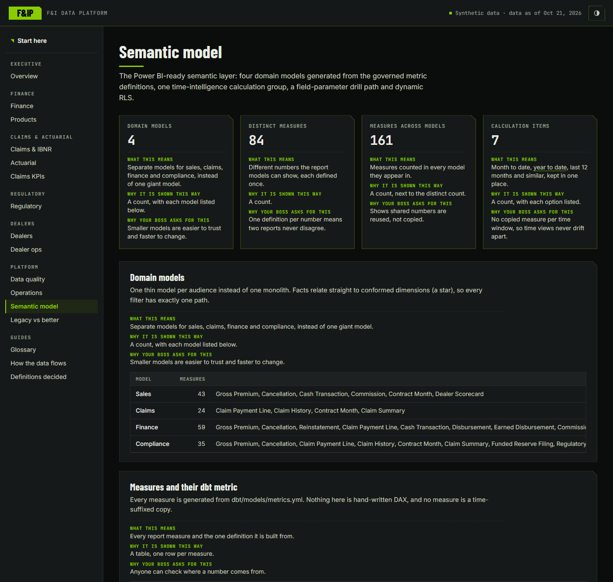 |
| **How the data flows.** Five steps from sale to report, then infographic 5 with what each check did in this run. | **Semantic model.** The Power BI-ready layer: four domain models from one `metrics.yml`, one calculation group, row-level security. |

## Infographics

Six one-page pictures, drawn from the same run (`python -m reports.infographics`; each is an SVG plus a 1600 px
PNG in dark and light, in [docs/img/infographics/](docs/img/infographics/), with every number and its source in
[numbers.json](docs/img/infographics/numbers.json)). GitHub shows the version that matches your theme.

<table>
<tr><td width="50%"><picture><source media="(prefers-color-scheme: dark)" srcset="docs/img/infographics/01-contract-life-dark.png">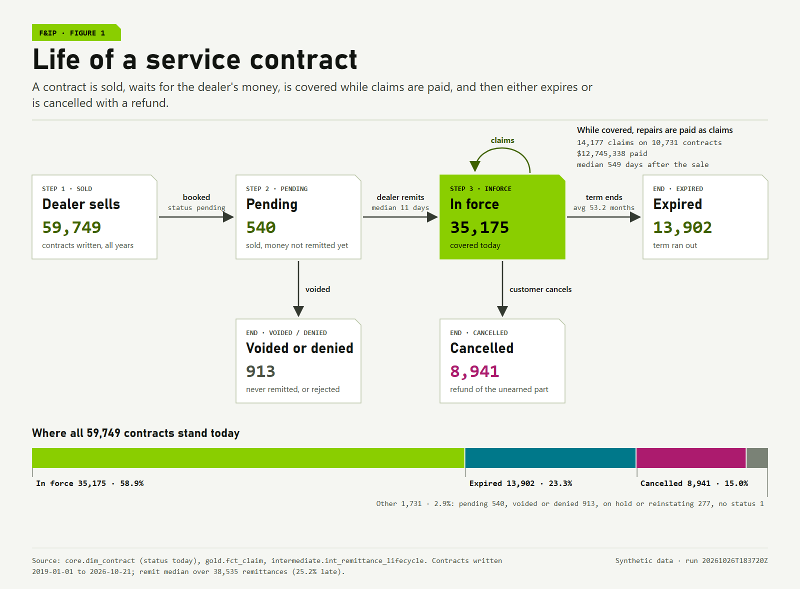</picture></td><td width="50%"><picture><source media="(prefers-color-scheme: dark)" srcset="docs/img/infographics/02-contract-dollar-dark.png">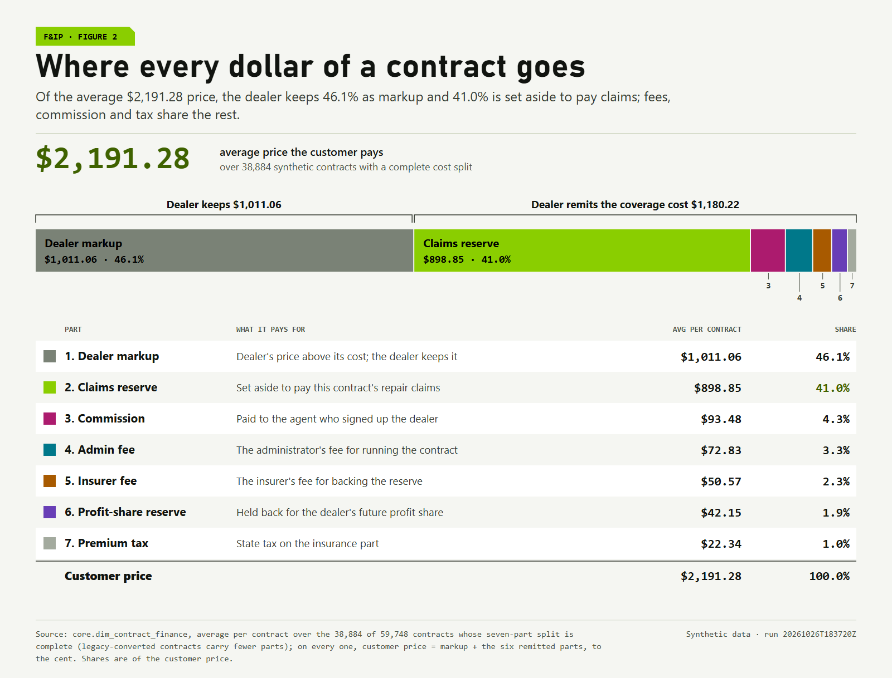</picture></td></tr>
<tr><td width="50%"><picture><source media="(prefers-color-scheme: dark)" srcset="docs/img/infographics/03-earned-vs-written-dark.png">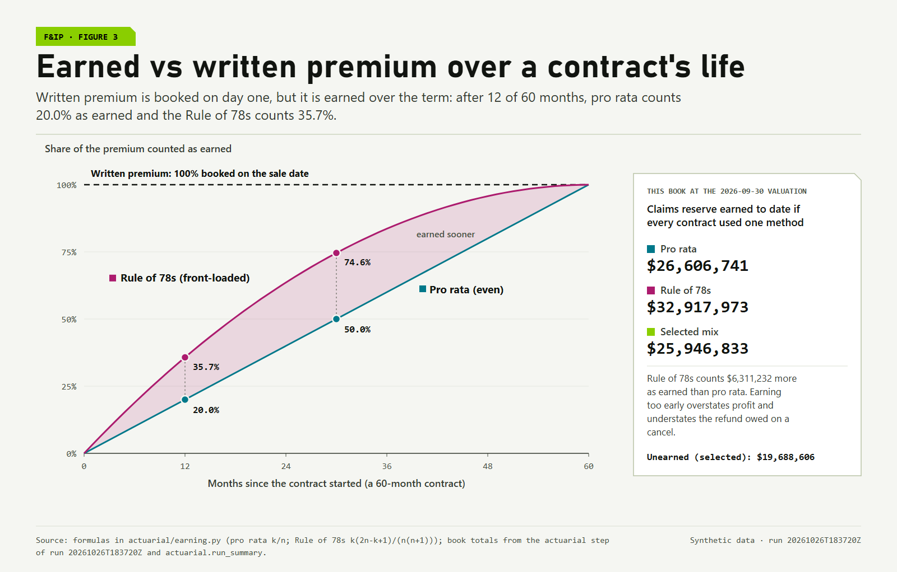</picture></td><td width="50%"><picture><source media="(prefers-color-scheme: dark)" srcset="docs/img/infographics/04-dealer-participation-dark.png">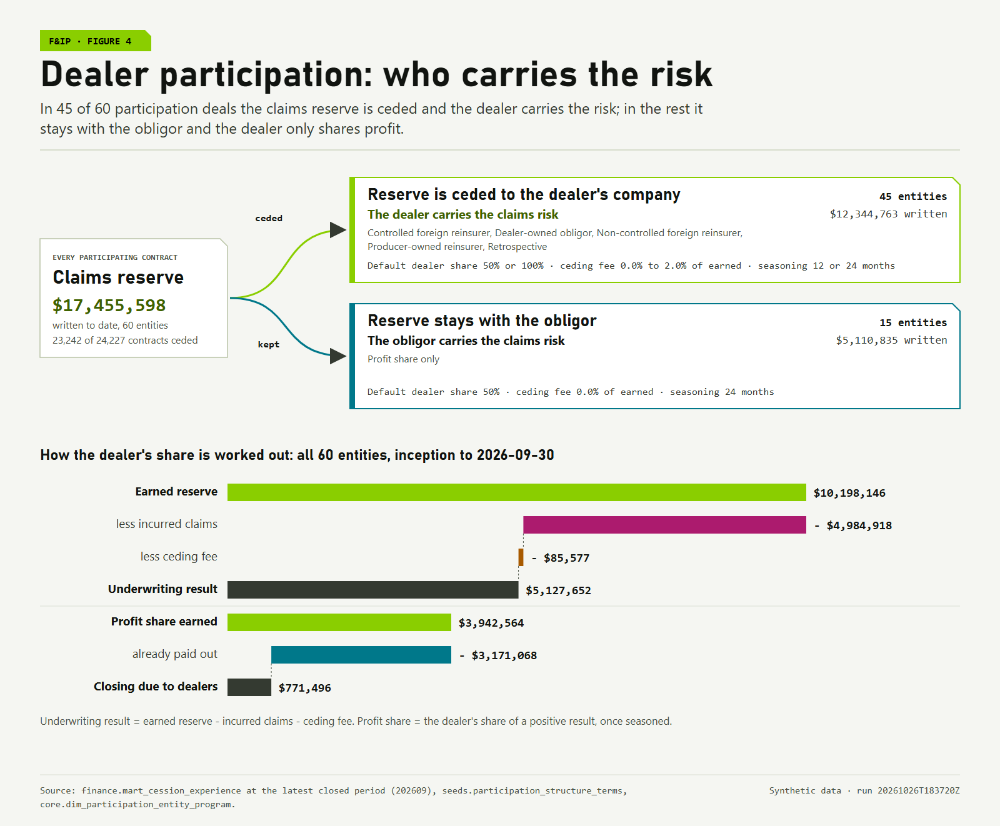</picture></td></tr>
<tr><td width="50%"><picture><source media="(prefers-color-scheme: dark)" srcset="docs/img/infographics/05-data-flow-gates-dark.png">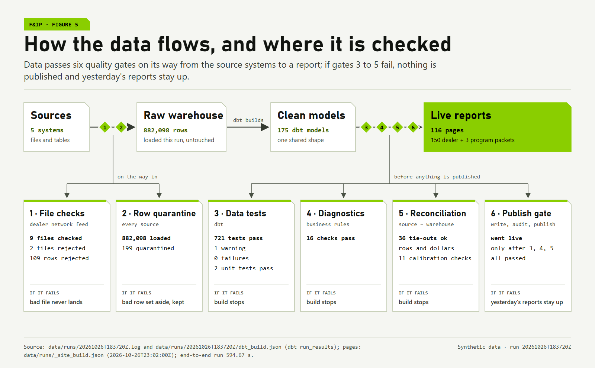</picture></td><td width="50%"><picture><source media="(prefers-color-scheme: dark)" srcset="docs/img/infographics/06-legacy-vs-better-dark.png">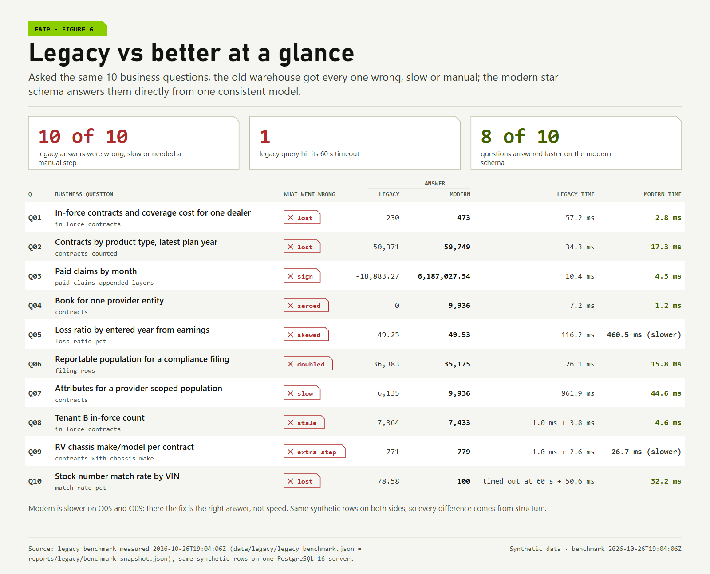</picture></td></tr>
</table>

## Legacy vs better

The usual way a VSC administrator's reporting grows up, and what this platform does instead. The longer version
is in [docs/LEGACY_VS_BETTER.md](docs/LEGACY_VS_BETTER.md).

| Typical legacy setup | This platform |
|---|---|
| Reports pulled straight from the admin system's database, then fixed by hand in Excel | Reports read tested marts only; raw and staging tables are never queried by a report |
| One giant BI model with hundreds of copy-pasted measures (MTD, QTD, YTD copies of each) | Four domain models generated from one `metrics.yml`, plus **one** time-intelligence calculation group |
| Counting rules ("which statuses count as in force?") hidden in spreadsheet comments | Counting rules are seed tables with tests ([report definitions](dbt/seeds/regulatory/)) |
| Inner joins to a stale product table silently drop new contracts | Left joins plus a match-rate gate by entered year; the run stops below 99.5% |
| Contract facts at transaction grain, so joins fan out and double-count | A fan-out guard on every contract-grain model: rows must equal distinct contracts |
| Claim amounts stored negative in one source, positive in another | Signs conformed once in staging, with a test on both sides |
| Demo and test dealers filtered in every query (or forgotten) | Excluded once, in `int_reportable_scope`, and checked by a gate |
| Status history starts the day someone first saved a snapshot | Daily SCD2 snapshots from day one, plus a history backfill |
| Hand-built Excel exports emailed to each dealer | Per-dealer packets and a raw-data portal, both scoped by the same access map |
| "Does this match the source?" answered after a complaint | Source-to-mart reconciliation on every run, stored in `audit.reconciliation` |

## How we got here

The platform tells the whole history of a VSC administrator's reporting, not just the end state
([details](docs/LEGACY_VS_BETTER.md)):

| Stage | What it was | What this repo does about it |
|---|---|---|
| 1. App-database reporting | Views and CSV exports straight from the admin app; no history | The legacy admin system is kept as a source; CDC and daily SCD2 snapshots give history from day one |
| 2. BI over the operational database | One giant model, copied MTD/QTD/YTD measures | Four domain models generated from `metrics.yml`, one calculation group |
| 3. Partner feeds and white-label programs | Daily dealer files, partner programs needing their own branding and scope | Data contracts, quarantine, and per-partner-program (tenant) scoping everywhere |
| 4. Warehouse migration | Move to an orchestrated, layered warehouse | Legacy book (before the 2023-01-01 cutover) and Admin Core load side by side, tied out by reconciliation |

## How it was, and how we fixed it

Reporting teams at many VSC administrators work on a warehouse that grew one urgent request at a time: a schema
per source system, each with its own BI model, views over views, no keys, a second tenant copied into its own
schema, and a custom-field store in the admin system's own database. Every analyst learns the traps by being
burned by them. This repo rebuilds that warehouse **on purpose** (`python -m legacy build`, a separate PostgreSQL
database built from the same synthetic raw rows) and answers the same ten business questions on it and on the
modern star schema (`python -m legacy demo`). Measured on synthetic data at about 60k contracts:

| Pain point (legacy) | Measured on the legacy side | Modern answer | Root-cause fix |
|---|---|---|---|
| Duplicate dealer ids (active, inactive copy, prefixed) | one dealer id finds 230 of 467 in-force contracts | 473 | dealer master + crosswalk |
| Stale product dim, inner-joined | 50,371 of 59,985 contracts kept; latest plan year shows as 2025 | 59,749; 2026 | full dim + unknown member (-1) + build test |
| Claim sign negative in one layer, positive in another | paid claims net to -$18,883 over 24 months | $6,187,027 | sign fixed once in staging |
| "Producer" means dealer in one layer, provider in another | provider's book = 0 contracts | 9,936 | `producer_role` on `dim_producer` |
| Test/API contracts, demo dealers, fan-out on a shared dealer number | filing pulls 36,383 rows (1,174 doubled, 32 test, 127 demo) | 35,175 | scope rules applied once |
| Union-spine contract "dim" | 961.9 ms for a provider-scoped lookup of 6,135 contracts (21.5x slower) | 44.6 ms | one contract dim table with a key |
| Text-normalized VIN joins, no keys | correlated lookup timed out at 60 s; exact join loses 21% (8,897 of 41,537) | 100% on the key | enforced PK/FK, VIN normalized once |
| Tenant B as a mirror schema | copied query errors; mirror lags (7,364 vs 7,433 in force) | one table + RLS | tenant column + row-level security |
| Sentinel date in the earnings series | 2019 loss ratio 49.25% vs 48.89% with the dropped rows | no sentinel rows | NULL + flag in staging, date index |
| EAV custom fields in another database | one-query join impossible; two steps + export | one query | pivoted to typed columns |
| Backups, empty shells, personal schemas | 22 registry findings | 0 | schema registry + CI clutter check |
| Workspace sprawl: generation copies, test copies in prod, a workspace per client, a model per report, person-owned items | not a query (BI-service structure) | one certified model, three staged workspaces | deployment pipeline only, group-owned items, endorsement + labels |

Every entry, with its plan, timing and where the fix lives, is in
[docs/LEGACY_BENCHMARK.md](docs/LEGACY_BENCHMARK.md) and on the site page **Platform > Legacy vs better**. Both are
generated from the last measured run, so the numbers above are real; rerun `python -m legacy demo` to refresh them.
The analyst query patterns used to survive the old warehouse are in [sql/playbook/](sql/playbook/README.md).

## Scoping and environments

A **tenant** is a white-label partner program (here `LKS`, `NGT` and `PVA`). Every view of the data is scoped
twice, by partner program and by dealer, from one user-to-dealer-and-tenant map: the raw-data portal
(`--tenant T --dealer D`), the per-dealer packets in `site/dealers/<tenant>/<dealer>/` (each branded for its
program), the semantic model's RLS roles (Tenant Partner, Dealer User) and the Postgres and Snowflake row
access policies.

**Dev, UAT and prod run locally.** `python -m pipeline.run --env dev|uat|prod` ([pipeline/envs.py](pipeline/envs.py))
points every path at one environment, so a UAT build never touches prod output:

| Env | Warehouse | dbt target | Sources, site, publish, run logs |
|---|---|---|---|
| prod (default) | `data/warehouse/warehouse.duckdb` | `dbt/target` | `data/source`, `data/landing`, `site`, `data/publish`, `data/runs` |
| uat | `data/env/uat/warehouse.duckdb` | `dbt/target_uat` | `data/env/uat/...` |
| dev | `data/env/dev/warehouse.duckdb` | `dbt/target_dev` | `data/env/dev/...` |

UAT and dev start from a one-time copy of the prod sources (the local stand-in for a zero-copy clone).
Before promotion, [tools/env_diff.py](tools/env_diff.py) compares every mart table's row count and money totals
in UAT with prod; a difference passes only if the change ticket's `--expect` CSV explains it
([RELEASE](docs/operating-model/RELEASE.md)). On a server the same three tiers are the dbt targets in
[dbt/profiles.yml](dbt/profiles.yml) (`SNOWFLAKE_DATABASE` = `ANALYTICS_DEV`, `ANALYTICS_UAT` or `ANALYTICS`)
and the zero-copy clones in
[warehouse/snowflake/07_environments_clone.sql](warehouse/snowflake/07_environments_clone.sql) (written, not
executed here); the BI workspaces per environment are in [ACCESS_MATRIX](docs/ACCESS_MATRIX.md).

## Quickstart

Python 3.12+ (tested on 3.13).

**Windows PowerShell**

```powershell
python -m venv .venv
.venv\Scripts\python.exe -m pip install -r requirements.txt
.venv\Scripts\python.exe -m pipeline.run                # full run from nothing, about 10 minutes
.venv\Scripts\python.exe -m pipeline.run --append-day   # next business day: CDC loads only new versions
start site\index.html
```

`tasks.ps1` wraps the same commands: `.\tasks.ps1 setup | lint | test | run | day | dbt | docs | clean`.
`.\tasks.ps1 demo` (`make demo`) fills the operations page's run history: a build, three daily runs, and one
injected reconciliation-gate failure (a late source batch after the extract) with its recovery run
([tools/demo_history.py](tools/demo_history.py), `--dry-run` prints the plan). `.\tasks.ps1 schedule` registers a
weekday 06:00 `day` run, so the 7 AM SLO table builds up real day-by-day history.

**bash (macOS / Linux / Git Bash)**

```bash
python3 -m venv .venv
.venv/bin/python -m pip install -r requirements.txt
.venv/bin/python -m pipeline.run
open site/index.html   # or xdg-open
```

Useful flags: `--from dbt` resumes from a step, `--only publish reports` runs a subset (it is refused if a gate
failed), and `--seed 7` builds a different synthetic world. Each run writes a JSON summary to `data/runs/` and a
row to `audit.pipeline_run`.

**Try a change in UAT, then promote it**

```powershell
.venv\Scripts\python.exe -m pipeline.run --env uat                          # build into data/env/uat (prod untouched)
.venv\Scripts\python.exe tools\env_diff.py --expect <ticket>_expected_diffs.csv  # UAT vs prod; exit 1 on an unexplained diff
# promote: merge the change; the next prod run (no --env) rebuilds prod from source
```

The diff's latest result is saved to `data/env/env_diff.json`, and the Operations page shows it once a check has
run (a fresh build has none yet; see the [roadmap](docs/ROADMAP.md)). Sample output is in
[RELEASE](docs/operating-model/RELEASE.md#sample-promotion-check).

Other entry points:

```powershell
.venv\Scripts\python.exe -m portal export --tenant PVA --dealer D1001   # one dealer's raw data, nobody else's
.venv\Scripts\python.exe -m portal serve                               # the same, as a read-only HTTP API + browser UI at /ui (portal/README.md)
.venv\Scripts\python.exe -m semantic --check                           # semantic model is in sync with metrics.yml
.venv\Scripts\python.exe -m pytest -q; .venv\Scripts\python.exe -m ruff check .
```

**Raw-data portal in the browser.** `python -m portal serve` also serves a sign-in page at
`http://127.0.0.1:8765/ui` (get a demo key with `python -m portal demo-key --login d1001.admin`). A dealer sees
previews and CSV/JSON downloads of its own contracts, claims, cancellations and remittances, contact data only
as a dealer admin, and its own access log. Isolation is checked on the server for every request, and every read
or refusal is logged. It is a local demo (plain HTTP, in-memory sessions); see [portal/README.md](portal/README.md).

## Real Power BI on a real database

The default run needs no servers. As an opt-in extra, the marts are copied into a real local PostgreSQL 16
database and a seven-page Power BI report reads from it. Everything below runs as your own Windows user: no
admin rights, no Windows service, no Docker.

1. **Get the two free programs.** PostgreSQL 16 binaries (the zip from EDB, unzipped to a folder you own) and
   Power BI Desktop (free, from the Microsoft Store). Copy `.env.example` to `.env` and fill in the server
   paths and two passwords. `.env` is git-ignored. Creating the database cluster is a one-time step
   ([one-time setup](warehouse/postgres/README.md#one-time-setup-no-admin-rights-no-docker)).
2. **Start the server.** `powershell -ExecutionPolicy Bypass -File tools\pg.ps1 start` (`status`, `stop`,
   `psql` also work). It listens on `127.0.0.1:5432` only. Start it again after a reboot.
3. **Load the warehouse.** `pip install -r requirements-postgres.txt`, then
   `python -m pipeline.run --postgres`. After every gate passes, `python -m warehouse.postgres sync` copies 140
   tables (13,175,252 rows in the last recorded sync) into the `vsc_analytics` database in one transaction, adds keys, indexes and
   row-level security, and ties out row counts and dollar totals against DuckDB before it commits. A mismatch
   rolls everything back. `python -m warehouse.postgres reconcile` re-checks at any time.
4. **Open the report.** Double-click `powerbi\FI Data Platform.pbip` and click **Refresh now**. Sign in on the
   **Database** tab as `bi_reader` (password `PG_BI_READER_PASSWORD` in `.env`); if Desktop asks, connect
   without encryption (the server is local only). The first refresh loads about 13.1M rows and takes a few
   minutes. Pages: executive overview, dealer scorecard, claims and IBNR, regulatory funded reserve, finance.
5. **Test dealer security.** Modeling > View as > Other user, enter a `user_login` from
   `core.dim_user_dealer_access` and tick Dealer User: every page narrows to that user's dealers.

The report is a Power BI project (PBIP/PBIR text files), generated by `python -m powerbi` from the same plan as
the semantic model, so every measure still maps to a metric in `metrics.yml`. `python -m powerbi --check
--validate` checks it against Microsoft's published JSON schemas and confirms every field a visual uses exists in
the model. `python -m semantic --target postgres` writes the four domain models pointed at Postgres
(`semantic/model_postgres/`). Details: [warehouse/postgres](warehouse/postgres/README.md),
[powerbi](powerbi/README.md).

## Architecture

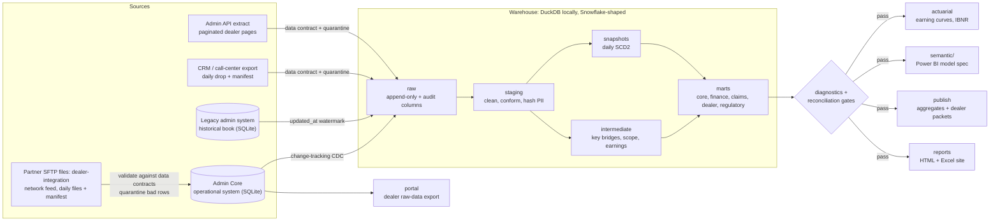

The ten pipeline steps run in order as separate processes: generate, feed, ingest, dbt, diagnostics, reconcile,
actuarial, semantic, publish, reports. Steps after the gates never run when a gate fails.

| Layer | Runs locally | Production shape (written, not executed here) |
|---|---|---|
| Operational source | Admin Core and legacy system in SQLite | SQL Server with change tracking |
| Intake | Daily dealer-feed landing folder with manifest checksums; CRM call-center export and paginated admin API extract, each with a data contract and quarantine. CRM contacts feed `core.fct_call_center_contact` and claim contact rates; the admin-API roster is checked against `dim_dealer` by a reconciliation gate test; both are tied out in `audit.reconciliation` | Partner SFTP, CRM exports and admin API pulls |
| Warehouse | DuckDB, one schema per layer | Snowflake `RAW` / `ANALYTICS` databases, see [warehouse/snowflake/](warehouse/snowflake/) |
| Transform | dbt Core (170+ models, 4 snapshots, 26 seeds, 740+ data tests; counts from `dbt/target/manifest.json`) | the same project on the dbt `snowflake` target |
| Orchestration | `python -m pipeline.run` | Airflow DAG calling the same steps ([pipeline/airflow/](pipeline/airflow/)) |
| BI | Static HTML + Excel site, TMDL model spec; opt-in: PostgreSQL copy of the marts + a Power BI project (PBIP) that opens and refreshes in Desktop | Power BI semantic models with dynamic RLS on Snowflake |

Details: [ARCHITECTURE](docs/ARCHITECTURE.md), [DATA_MODEL](docs/DATA_MODEL.md), [METRICS](docs/METRICS.md),
[V3 design contract](docs/V3_DESIGN.md), [RUNBOOK](docs/operating-model/RUNBOOK.md).

## What it builds

- **Admin Core**, a generic multi-tenant admin system with 13 modules: rating, contracts, dealers and agents,
  remittance (entered, sent, received), dealer-cost disbursements, cancellations and reinstatements, amendments,
  claims with payment lines, participation entities, commissions and white-label administrator branding.
- **Accounting-grade facts.** Every financial fact carries a posting-period key, so a late event never restates
  a closed month. There is one claims fact, at payment-line grain, and every claims roll-up comes from it.
- **Reports** ([docs/REPORTS.md](docs/REPORTS.md)): state funded-reserve filings and market surveys (Excel and
  HTML, with a methodology-notes column), dealer production and pending contracts, remittance aging with late
  fees, surcharge audit, specialty line, claims KPIs, cession and experience, profit-share statement, commission
  statement, P&L by product, actuarial reserves, and an operations page with run history.
- **Semantic layer** ([semantic/](semantic/)): Sales, Claims, Finance and Compliance models, generated from
  [dbt/models/metrics.yml](dbt/models/metrics.yml). A test proves every measure maps to a metric.
- **Power BI report** ([powerbi/](powerbi/)): a seven-page PBIP project over a reconciled PostgreSQL copy of the
  marts, with dealer row-level security (opt-in, see [Real Power BI on a real database](#real-power-bi-on-a-real-database)).
- **Raw-data portal** ([portal/](portal/README.md)): a CLI, a read-only HTTP API and a browser UI, all scoped to
  one dealer or one partner program and written to an access log.
- **Operating model** ([docs/operating-model/](docs/operating-model/)): SLAs, runbook, incident template, an
  example postmortem, intake form, release process and data dictionary. Access is set out in
  [ACCESS_MATRIX](docs/ACCESS_MATRIX.md).

## How it was built

A note on the build process: the code was written with AI coding agents, each assigned one role on a
typical data department's org chart and reviewed against the design contract. Each role owns
its files (see section 3 of the [design contract](docs/V3_DESIGN.md)), works on its own warehouse copy, and
reports back what it built, how it checked it, and what is still open.

| Title | Owns |
|---|---|
| **Senior Director** | Final sign-off, this README, the legacy-vs-better story, the brand-scrub check |
| **Director** | Architecture and the binding design contract, data model, integration of every area |
| **Reporting Manager** | The report site shell, report docs, the operating-model docs |
| **Senior Data Analyst (regulatory)** | Funded-reserve filings, market surveys, counting-rule seeds |
| **Senior Data Analyst (dealer & claims)** | Dealer production, pending contracts, surcharge audit, specialty line, claims KPIs |
| **Senior Power BI Specialist** | `metrics.yml`, the semantic model generator, RLS roles, the calculation group |
| **Financial Analyst II** | Profit share, cession and experience, P&L by product, finance controls |
| **Financial Analyst I** | Remittance aging, commission statements, cash tie-outs |
| **Data Engineering Manager** | dbt project layout, diagnostics and reconciliation gates, publish, Snowflake scripts |
| **Data Engineer** | Generator, Admin Core, dealer feed and data contracts, CDC ingest, portal |
| **Data Scientist** | Actuarial module: earning curves, loss triangles, IBNR, early-claim emergence |
| **Data Engineer / Data Scientist** | The bridge between ingest and modeling: snapshots, history backfill, forecast back-tests |

## Checks

| Check | Command |
|---|---|
| Full run, gates included | `python -m pipeline.run` |
| Python tests (750+ pytest tests, including injected gate failures) | `python -m pytest -q` |
| Lint | `python -m ruff check .` |
| Semantic model in sync (both targets) | `python -m semantic --check`, `python -m semantic --target postgres --check` |
| Power BI project in sync and valid | `python -m powerbi --check --validate` |
| Postgres copy ties out (opt-in; its tests skip without a server) | `python -m warehouse.postgres reconcile` |
| Brand scrub (needs the private term list) | `python tools/brand_scrub.py` |
| README results strip, badges, case study, banner, social preview, walkthrough GIF (after `python -m reports`) | `python tools/showcase_assets.py` |

## Known limitations

The full ranked list, with value, risk, effort and owner for each item, is in [docs/ROADMAP.md](docs/ROADMAP.md).
The top items:

1. **The legacy in-force book is not migrated.** 15,873 contracts in force at the 2023-01-01 cutover
   ($19.6M coverage cost) stay on the legacy system of record. Reconciliation reports them as `not_migrated`, a
   documented exclusion, so "Reconciliation breaks 0" does not include them.
2. **No SLO history yet.** The 7 AM SLO has no tracked days until scheduled daily runs build it up
   (`.\tasks.ps1 demo` fills a demo history; `.\tasks.ps1 schedule` starts the real one).
3. **No live UAT-to-prod promotion check yet.** `tools/env_diff.py` works, but no `data/env/env_diff.json` exists
   until a UAT build is diffed against prod.
4. **One definition still to merge**: remittance late fees (dealer vs finance marts); the combined ratio now has
   one formula, the P&L's ([METRICS](docs/METRICS.md#open-governance-items)).
5. Several V1 pages still read the retired `gold` / `silver` schema names through compatibility views.
6. The Snowflake scripts, the dbt `snowflake` target and the Airflow DAG are written but not executed here.
   Running them needs accounts or Docker. The Postgres target is real but opt-in: a local server, a
   reconciled copy of the marts and a Power BI model pointed at it ([warehouse/postgres](warehouse/postgres/README.md)).
7. The full run takes about 10 minutes (594.67 s on the last verified run) against a 5-minute goal; dbt (about
   4 minutes) and generate plus ingest (about 2 minutes) are the largest steps.

## Author

Built by **Michael Hanson** ([GitHub](https://github.com/MichaelH117) · [LinkedIn](https://linkedin.com/in/michaelhanson117)).
All data is synthetic. Licensed under the [MIT License](LICENSE).
