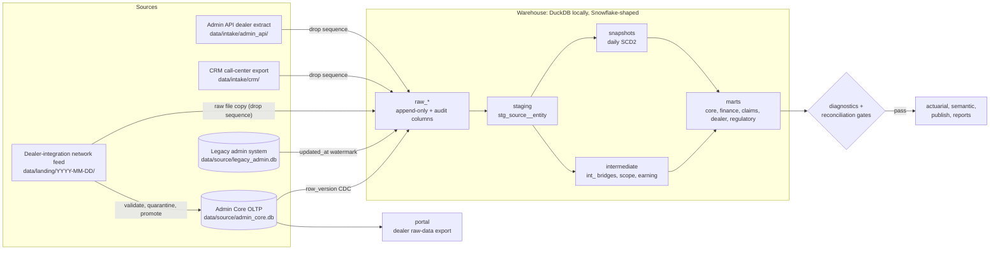

# Architecture

Owner: Director. This page is the short tour of the V3 platform for a new hire: what runs, in what order, where
the data lives and how to recover a bad run. The binding contract with every detail is
[V3_DESIGN.md](V3_DESIGN.md) (sections 1 to 5); column-level detail is in [DATA_MODEL.md](DATA_MODEL.md).
**All data is synthetic.**

## Constraint

Everything runs on a laptop with one command, `python -m pipeline.run`, with **no Docker, no servers and no paid
accounts**, in about 3 minutes. Production-shaped pieces (Snowflake scripts, the dbt `snowflake` and `postgres`
targets, Postgres RLS, the Airflow DAG) are written in the repo and parsed by tests, but not executed.

## Layers

## The ten steps

Each step is its own `python -m` subprocess, timed and logged; the run stops at the first non-zero exit.

| # | Step | Command | What it does |
|---|---|---|---|
| 1 | generate | `python -m generator` | Builds the two source DBs and the landing and intake drops (skipped when Admin Core exists and the seed matches) |
| 2 | feed | `python -m ingest.feed` | Checks each landing drop against its manifest and data contracts, quarantines bad rows, promotes the rest into Admin Core |
| 3 | ingest | `python -m ingest` | CDC from all five sources into `raw_*` |
| 4 | dbt | `dbt build` | Seeds, models, snapshots and data tests |
| 5 | diagnostics | `python -m pipeline.diagnostics` | **Gate**: the eight `diag_*` checks |
| 6 | reconcile | `python -m pipeline.reconcile` | **Gate**: row and dollar tie-out source to raw to marts |
| 7 | actuarial | `python -m actuarial` | Earning curves, triangles, IBNR |
| 8 | semantic | `python -m semantic` | TMDL-style model spec from `dbt/models/metrics.yml` |
| 9 | publish | `python -m publish` | Aggregate data products and per-dealer packets |
| 10 | reports | `python -m reports` | Static HTML and Excel site in `site/` |

**Gate rule:** steps 7 to 10 never run when step 4, 5 or 6 fails. `--from` and `--only` read the last gate result
from `data/runs/_gates.json` and refuse to skip a failed gate. Each run writes `data/runs/<run_id>.json` and a
row in `audit.pipeline_run`.

## Sources and watermarks

| Source | Local file | Raw schema | Watermark (`_source_version`) |
|---|---|---|---|
| Admin Core (stands in for SQL Server) | `data/source/admin_core.db` | `raw_admin_core` | `row_version > watermark`, the global change-tracking version; soft deletes arrive as `removed_from_source = 1` |
| Legacy admin system (book before the 2023-01-01 cutover) | `data/source/legacy_admin.db` | `raw_legacy_admin` | `updated_at` with a five-minute look-back, de-duplicated by row fingerprint; a key diff writes tombstones for hard deletes |
| Dealer-integration network feed | `data/landing/YYYY-MM-DD/` | `raw_network_feed` | the drop's sequence number; every delivered row is kept, plus `_manifest` and `_quarantine` |
| CRM call-center export | `data/intake/crm/` | `raw_crm` | drop sequence number |
| Admin API dealer extract | `data/intake/admin_api/` | `raw_admin_api` | drop sequence number |

A watermark advances in the same transaction as the load, so a crash re-pulls the same window. Rows that break a
data contract (`contracts/*.yml`) go to the source's `_quarantine` table with `reject_reason` and `raw_json`, and are
never promoted.

Every raw table carries the audit columns `_loaded_at`, `_loaded_by` (`ingest@<run_id>`), `_source_system`,
`_source_version`, `_is_deleted` and `_run_id`; feed and intake tables add `_source_file`, `_file_sha256`,
`_row_number` and `_feed_date`. Underscore columns are pipeline metadata and never reach reports.

## Warehouse schemas

| Layer | DuckDB schema | Snowflake | Built by |
|---|---|---|---|
| raw | `raw_admin_core`, `raw_legacy_admin`, `raw_network_feed`, `raw_crm`, `raw_admin_api` | `RAW.<SOURCE>` | ingest (append-only) |
| audit | `audit` | `RAW.AUDIT` | ingest, gates, run log |
| staging | `staging` | `ANALYTICS.STAGING` | dbt views `stg_<source>__<entity>` |
| intermediate | `intermediate` | `ANALYTICS.INTERMEDIATE` | dbt `int_*` |
| seeds | `seeds` | `ANALYTICS.SEEDS` | dbt seeds |
| snapshots | `snapshots` | `ANALYTICS.SNAPSHOTS` | dbt snapshots `snap_*` |
| marts | `core`, `finance`, `claims`, `dealer`, `regulatory` | `ANALYTICS.<DOMAIN>` | dbt tables |

Reports, publish, actuarial and the semantic model read **marts only**. The V1 schema names (bronze, silver and
gold) are retired; a few deprecated V1-shaped views in `dbt/models/marts/core/v1_compat/` keep older pages running
for one release and must not be built on.

## Environments

`python -m pipeline.run --env dev|uat|prod` ([pipeline/envs.py](../pipeline/envs.py)) gives each environment its
own sources, warehouse, dbt target, site, publish and run-log folders. Prod is the default layout
(`data/warehouse/warehouse.duckdb`); UAT and dev live under `data/env/<env>/` and start from a copy of the prod
sources. `python tools/env_diff.py` compares UAT with prod before a promotion
([RELEASE](operating-model/RELEASE.md)). Parallel agents use their own warehouse copy plus `WAREHOUSE_PATH`,
`DBT_TARGET_PATH=target_<role>` and `DBT_LOG_PATH` (design 4.2).

## Recovery

| Situation | Command | What happens |
|---|---|---|
| A step failed; the fix is in that step or later | `python -m pipeline.run --from <step>` | Resumes in pipeline order; earlier steps are not re-run |
| A model or seed fix | `python -m pipeline.run --from dbt` | Rebuilds dbt, then re-runs both gates |
| Raw data must be reloaded | `python -m pipeline.run --from ingest --full-refresh` | Drops the raw schemas and watermarks, reloads every source in full and runs dbt with `--full-refresh` |
| One source must be reloaded | `python -m ingest --sources legacy_admin --full-refresh`, then `python -m pipeline.run --from dbt --full-refresh` | Only that source's raw schema and watermarks are dropped |
| A source was rebuilt (new seed or regenerated DB) | `python -m pipeline.run --seed N` | The generator stamps a new source epoch; ingest sees it, reloads that source in full, and the pipeline runs dbt with `--full-refresh` and rebuilds the snapshots |
| Next business day | `python -m pipeline.run --append-day` | New source activity; CDC loads only the new versions |

Per-check fixes are in the [RUNBOOK](operating-model/RUNBOOK.md).

## Orchestration and CI

The Airflow DAG in `pipeline/airflow/` calls the same ten steps in the same order (a test checks it matches
`pipeline.run.STEPS`). CI (`.github/workflows/ci.yml`) runs ruff, pytest, the dbt build on DuckDB and a full run
plus one appended day.
