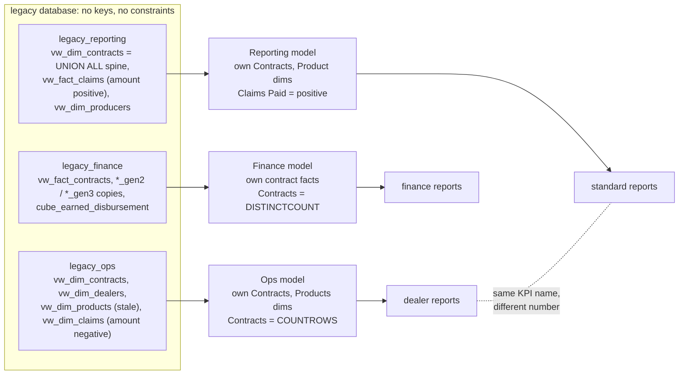
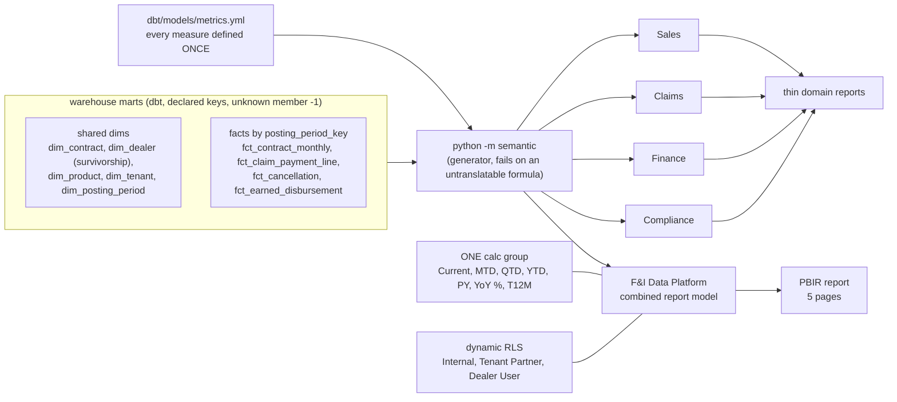

# Semantic strategy: one model per schema vs one conformed star

A Power BI semantic model is the layer between the warehouse and every report. It holds the tables,
the relationships between them, the measures (the DAX formulas behind every number) and the security
roles. If this layer is wrong, every report built on it is wrong in the same way.

This page compares two ways to build it:

- **Legacy:** one semantic model per source schema (Ops, Finance, Reporting). It is rebuilt as a
  working anti-pattern in `legacy/semantic_models/` by `python -m legacy semantic`.
- **Ours:** one conformed star schema, shared dimensions, measures defined once in
  `dbt/models/metrics.yml`, four domain models plus one combined report model, one calculation group
  and dynamic RLS. It lives in `semantic/model/` and `powerbi/FI Data Platform.SemanticModel/`.

Every count on this page comes from the documentation export (`python -m semantic export-docs`, see
[the export](#the-documentation-export)), so you can check it yourself.

## Legacy: one semantic model per schema



What goes wrong, in order of how much it costs:

| Problem | What it looks like in the legacy specs | Why it hurts |
|---|---|---|
| **Conflicting measures** | `Contracts` is `COUNTROWS(Contracts)` in Ops but `DISTINCTCOUNT('Fact Contracts'[fxContractId])` in Finance and Reporting. `Claims Paid` sums a negative column in Ops and a positive one in Reporting. `Cancel Refunds` and `Coverage Cost` also differ between models | Two reports with the same tile title show different numbers. Nobody can say which is right without reading DAX |
| **Duplicated dimensions** | The contract dim is loaded twice (Ops and Reporting), contract facts twice (Finance and Reporting), the product dim twice (Ops and Reporting) | A fix in one copy (a new product, a dealer merge) does not reach the others. Refresh cost is paid three times |
| **The wrong-producer filter trap** | Ops `Contracts[Producers]` is the **selling dealer**. Reporting `Producers[Producer]` is the **provider entity** | A filter on a provider's name in the Ops model returns zero contracts, with no error. It reads as "no business", not "wrong column" (playbook `sql/playbook/13_producer_vs_provider_trap.sql`) |
| **No keys behind the relationships** | All 9 legacy relationships join on columns with no primary or foreign key (`Model_Relationships.csv`, `key_enforced = no`). Some join on a dealer *number*, or on text | Orphans silently fall into a blank row; duplicated dealer ids double rows |
| **No shared time logic, no security** | 0 calculation items and 0 RLS roles across the three models. Time variants are copies of measures | MTD/YTD rules drift per model. Row security is done by publishing separate copies |
| **Mid-migration copies** | Finance binds `Fact Contracts Gen2` and `Fact Cancels Gen3` next to the originals | Which table a visual used depends on who built it, and when |

## Ours: one conformed star, many thin consumers



| Principle | How it is built here | Check |
|---|---|---|
| **One definition per measure** | Measures are generated from `metrics.yml`. Each one carries `annotation dbt_metric`. The four domain models and the report model use the same definition, so `Loss Ratio (on earned premium)` is the same DAX in all five | `tests/test_semantic.py` (every measure maps to a metric); `Model_Documentation.csv` column `dbt_metric` |
| **Shared, conformed dimensions** | Dealer, Product, Contract, Tenant and Posting Period are the same mart tables in every model. A dealer merged by survivorship is merged everywhere | `Model_Relationships.csv`: every `to_source` is a `core.dim_*` table with a declared key |
| **Domain models + one combined report model** | Sales, Claims, Finance and Compliance each get only the facts and dims their audience needs. `F&I Data Platform` combines them for the cross-domain report. Both come from the same generator, so they cannot drift | `semantic/model/manifest.json` |
| **Time intelligence once** | One calculation group with 7 items, capped at the last **closed** period. The generator rejects a measure whose name carries a time word (MTD, YTD, PY ...) | `Model_Documentation.csv`, `object_type = calculation_item` |
| **Security in the model** | Dynamic roles over `Security User Access` (user to tenant and dealer), plus an Internal role with no row filter | `Model_Documentation.csv`, `object_type = rls_filter`; `docs/ACCESS_MATRIX.md` |
| **Names that cannot be confused** | The provider entity is the **Obligor** dimension and the seller is the **Dealer** dimension. There is no column called "producer" | playbook `sql/playbook/13_producer_vs_provider_trap.modern.sql` |
| **Clean before the model** | Sign convention, test/demo exclusion and the sentinel date are fixed once in dbt staging, not in DAX | `docs/LEGACY_VS_BETTER.md` |

### Side by side, measured from the export

| | Legacy (3 models) | Ours (4 domain + 1 report model) |
|---|---|---|
| Measures | 13, of which 4 names have 2-3 different definitions | 236 measure rows built from 80 dbt metrics; a name has one formula everywhere |
| Relationships | 9, none backed by a key | 334, all to one of 15 `core.dim_*` tables with a declared key; the one inactive relationship per model (claims by reported month) is used only through `USERELATIONSHIP` |
| Calculation items | 0 | 7 per model, one calc group |
| RLS filters | 0 | 3 roles in the report model with 34 table filters (Internal has none by design) |
| Report usage known? | No (the reports were never saved as PBIR) | Yes: `Report_Field_Usage.csv` maps every visual field; 42 of the report model's 84 measures are used directly, 10 more only inside another measure |

The 32 report-model measures that no visual uses are not dead code by mistake: they serve the domain
reports and the site. The map makes that visible, so a monthly usage review can retire the ones that
stay unused.

## The documentation export

`python -m semantic export-docs` (alias `export`) reads the TMDL folders and the PBIR report from disk
and writes four CSVs to `site/downloads/semantic/` (git-ignored; `--out DIR` to write elsewhere). It
does the job a Tabular Editor documentation script does, and adds the one thing such a script cannot
see: which report visual uses which field, read from the PBIR report-definition layer.

| File | One row per | Key columns |
|---|---|---|
| `Model_Documentation.csv` | measure, calculated column or table, calculation item, RLS filter, partition source | `model_set`, `model`, `object_type`, `table`, `name`, `expression` (DAX or M), `display_folder`, `format_string`, `description`, `dbt_metric`, `source_table` |
| `Model_Relationships.csv` | relationship, written as a SQL join map | `from_table`/`from_column` -> `to_table`/`to_column`, `is_active`, `from_source`, `to_source`, `key_enforced`, `sql_join` |
| `Report_Field_Usage.csv` | report -> page -> visual -> role -> field | `visual_type`, `visual_title`, `role` (Values, Category, filter, sort, formatting ...), `field_kind`, `filter_values`, `dax`, `source_table`, `source_column` |
| `Measure_Report_Map.csv` | measure | `depends_on`, `used_by_measures`, `direct_visuals`, `pages`, `visuals`, `via_measures`, `status` (`used`, `used_via_measure`, `unused`, `no_report`) |

Model sets: `modern_domain` (`semantic/model/`), `modern_report` (`powerbi/`, the model the PBIR report
binds to) and `legacy` (`legacy/semantic_models/`). Domain-model measures are matched to report use
through their `dbt_metric`, because the definition is shared. Legacy measures are always `no_report`.

```powershell
.venv\Scripts\python -m semantic export-docs                       # -> site\downloads\semantic\
.venv\Scripts\python -m semantic export-docs --out C:\temp\model_docs
.venv\Scripts\python -m pytest tests\test_semantic_export.py -q
```

The export needs no warehouse, no Postgres and no Power BI Desktop, and its output is byte-for-byte
the same for the same files. The DAX -> SQL method that starts from these CSVs is in
[`docs/DAX_TO_SQL.md`](DAX_TO_SQL.md).
