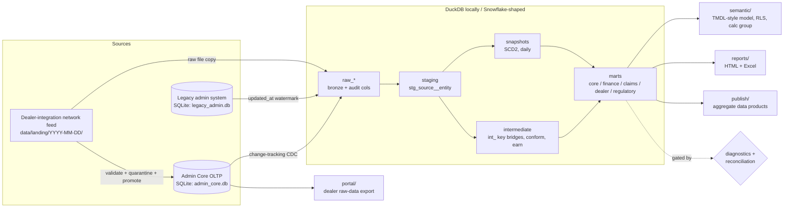

# V3 Design: Admin Core + Snowflake-shaped warehouse (binding team contract)

Owner: Director. Status: **binding**. If your code disagrees with this file, change the code or
ask the Director to amend this file. Do not quietly diverge.

Senior Director sign-off (2026-10-22): **approved** with the amendments marked in sections 3, 4.2,
6 and 7. The Director's three added decisions (scrub term list, Reporting Manager owns the report
shell, dealer & claims analyst owns `reports/claims/`) are approved.

V3 merges two ideas:
1. The admin team builds its own operational system (**Admin Core**) and a raw-data portal.
2. The data team moves the warehouse to a Snowflake-shaped layout with cleaner models and better reports.

Everything still runs locally with **no Docker, no servers and no paid accounts** through
`python -m pipeline.run`, in under about 5 minutes. All data is synthetic. Every name in the repo is
generic ("Provider A", "Obligor 1", "Insurer North", "Summit Motors", "dealer-integration network",
"admin system").

---

## 1. Target layer diagram



Pipeline steps, in order. Each step is its own `python -m` subprocess and the run fails fast:

| # | Step | Command | Owner |
|---|---|---|---|
| 1 | generate | `python -m generator [--seed N] [--append-day N]` | Data Engineer |
| 2 | feed | `python -m ingest.feed [--date YYYY-MM-DD]` (validate landing files, quarantine, promote into Admin Core) | Data Engineer |
| 3 | ingest | `python -m ingest [--full-refresh]` (CDC from Admin Core and legacy, plus raw feed files, into `raw_*`) | Data Engineer |
| 4 | dbt | `dbt build` (seeds, models, snapshots, tests) | Data Engineering Manager |
| 5 | diagnostics | `python -m pipeline.diagnostics` (gate) | Data Engineering Manager |
| 6 | reconcile | `python -m pipeline.reconcile` (gate) | Data Engineering Manager |
| 7 | actuarial | `python -m actuarial` | Data Scientist |
| 8 | semantic | `python -m semantic` (generate the model spec from `metrics.yml`) | Senior Power BI Specialist |
| 9 | publish | `python -m publish` | Data Engineering Manager |
| 10 | reports | `python -m reports` | Reporting Manager (shell) + area owners |

**Gate rule:** steps 7 to 10 never run when step 4, 5 or 6 exits non-zero. `pipeline/run.py` writes
the run summary to `data/runs/<run_id>.json` and appends one row per run to `audit.pipeline_run`.

---

## 2. Physical layout, tables and conventions

### 2.1 Files and environment variables
| Env var | Default (relative to repo root) | Used by |
|---|---|---|
| `ADMIN_CORE_PATH` | `data/source/admin_core.db` | generator, ingest.feed, ingest, portal, reconcile |
| `LEGACY_DB_PATH` | `data/source/legacy_admin.db` | generator, ingest, reconcile |
| `LANDING_DIR` | `data/landing` | generator, ingest.feed |
| `WAREHOUSE_PATH` | `data/warehouse/warehouse.duckdb` | ingest, dbt, every consumer |
| `DBT_TARGET_PATH` / `DBT_LOG_PATH` | `dbt/target` / `dbt/logs` | dbt (set per agent when running in parallel) |
| `AS_OF_DATE` | latest source activity | generator, dbt var `as_of_date` |

`SOURCE_DB_PATH` (V1) is retired. `pipeline/run.py` may keep reading it as an alias for
`LEGACY_DB_PATH` for one release.

### 2.2 Sources

**Landing feed** (`data/landing/YYYY-MM-DD/`), one folder per business day:
- `deals.csv`: deal_id, dealer_number, contract_number, vin, sale_date, product_code, plan_code, term_months, term_miles, odometer, purchase_price, coverage_cost, retail_price, lienholder_code, customer fields (fake), co-buyer fields `cobuyer_name`, `cobuyer_address_line1`, `cobuyer_city`, `cobuyer_state`, `cobuyer_zip` (fake; about a quarter of deals)
- `remittance.csv`: remit_batch_id, dealer_number, contract_number, remit_amount, remit_date
- `econtract_events.jsonl`: event_id, contract_number, event_type (RATED, CONTRACTED, VOIDED), event_at, payload
- `_manifest.json`: per file the row_count and sha256; plus feed_date and sequence number

Deliberate defects: wrong checksum, row-count mismatch, duplicate resend, remittance without a deal,
deal never remitted, late remittance, a void after contracting, bad VIN, unknown dealer.
Contracts live in `contracts/feed_<file>.yml` (Data Engineer). Rejected rows go to
`raw_network_feed._quarantine` with `reject_reason`, and they are never promoted.

**Admin Core** (SQLite, standing in for SQL Server). It is multi-tenant: every business table carries
`tenant_id`. It has 13 modules and these tables:

| Module | Tables (key columns) |
|---|---|
| Tenancy / white-label | `administrator` (tenant_id, administrator_code, reportable_name, logo_path, primary_color, secondary_color) |
| Parties | `dealer_group`, `dealer` (dealer_id, dealer_number, dealer_group_id, agent_id, state, is_demo, remit_rule, weekly_remit_flag), `agent`, `lienholder`, `account_holder` (account_holder_id, holder_type: ADMIN, INSURER, OBLIGOR, DEALER_RESERVE, AGENT, REPAIR_FACILITY) |
| Risk entities | `obligor` (obligor_id, state, obligor_name), `insurer` (program_type), `reinsurer` (status: ACTIVE, RUNOFF, runoff_date, cession_type, gl_class_code), `participation_entity` (entity_id, dealer_id, structure_type: DEALER_OWNED_OBLIGOR, CFC, NCFC, PORC, RETRO, PROFIT_SHARE; status, runoff_date, cession_type, gl_class_code) |
| Products / rating | `product_category` > `product_subcategory` > `product` (product_code, product_name `<name> <year> - <SUFFIX>`, contract_prefix, plan_year, is_cancellable, program_type) > `plan` > `program`; `rate` (rate_id, plan_id, coverage_level, term_months, term_miles, odometer_band, class_code, deductible_amount, coverage_cost, suggested_retail); `rate_component` (rate_id, disbursement_type, account_holder_id, amount, is_refundable, is_renewable) |
| Contracts | `contract` (contract_id, contract_number, dealer_id, agent_id, plan_id, rate_id, status, entered_date, effective_date, expiration_date, expiration_mileage, purchase_price, coverage_cost, retail_price, msrp, finance_type, finance_amount, apr, new_used, odometer, vin, chassis_vin, vehicle_year/make/model, fuel_type, cylinders, class_code, reportable_state, original_obligor_id, current_obligor_id, insurer_id, lienholder_id, program_type, claim_grace_days, is_esigned, finalized_at, in_service_date, customer PII), `contract_surcharge`, `contract_option`, `contract_status_history`, `contract_document` (document_id, contract_id, related_document_id, document_type: CONTRACT, CANCEL, OTHER, generated_at, form_code, document_name, is_deleted) |
| Amendments / renewals | `contract_amendment` (amendment_id, contract_id, amendment_type: AMEND, RENEWAL, TRANSFER, effective_date, delta_coverage_cost) |
| Remittance / cash | `remit_batch` (remit_batch_id, dealer_id, entered_at, sent_at, received_at, status: ENTERED, SENT, RECEIVED), `cash_transaction` (cash_txn_id, remit_batch_id, contract_id, amount, posted_at) |
| Accounting | `transaction` (txn_id, contract_id, txn_type: SALE, CANCEL, REINSTATE, AMEND, CASH, posted_at, amount), `disbursement` (disbursement_id, txn_id, contract_id, disbursement_type: ADMIN_FEE, INSURER_FEE, PREMIUM_TAX, COMMISSION, CLAIMS_RESERVE, PROFIT_SHARE_RESERVE, account_holder_id, amount) |
| Cancellations | `cancellation` (cancel_id, contract_id, cancel_date, initiated_by: CUSTOMER, LENDER, DEALER, reason, method: PRORATED, FULL_REFUND, R78, odometer, contract_age_days, refund_pct, cancel_fee, customer_refund, admin_portion, dealer_portion, coverage_cost_refund, dealer_profit_refund, admin_withheld_claims), `reinstatement` (reinstatement_id, cancel_id, contract_id, reinstated_at, status) |
| Claims | `claim` (claim_id, claim_number, contract_id, status, substatus, denied_reason, denied_category, repair_facility_id, adjuster_user_id, loss_date, reported_at, odometer, repair_order, towing_flag, goodwill_flag, authorization_required), `claim_component`, `claim_payment_line` (line_id, claim_id, posted_at, authorized_change, inspection_change, paid_amount, pending_amount), `claim_history` (claim_id, changed_at, from/to status, pre/post-deductible change, collected_deductible), `claim_note`, `complaint` |
| Commissions | `commission` (commission_id, contract_id, agent_id, amount, share_pct, is_advance) |
| Users / portal | `admin_user`, `portal_user` (portal_user_id, tenant_id, dealer_id, role) |
| Change tracking | `_ct_version` (single global counter) |

Every Admin Core business table has these columns: `created_at`, `updated_at`, `row_version`
(the global change-tracking version at the last write) and `removed_from_source` (0/1, a soft delete).
Contract numbers use the product prefix plus a sequence (`VSC-`, `GAP-`, `BNDL-`, `TECH-`, `RV-`,
`PSP-`, ...). A test contract range (`*-9999xxxx`) and demo dealers (`is_demo = 1`) exist by design.

**Admin screen -> raw columns (V6 edit A).** Where each group or tab of the admin contract screen
lands in `raw_admin_core`. Only the header fields that were missing were added (`claim_grace_days`,
`is_esigned`, `finalized_at`, `in_service_date`); `claim_wait_days` and `finance_type` already existed.

| Screen group / tab | Raw table.column |
|---|---|
| Header: number, status, dates | `contract.contract_number`, `status`, `entered_date`, `effective_date`, `expiration_date`, `finalized_at`, `is_esigned` |
| Header: coverage terms | `contract.term_months`, `term_miles`, `expiration_mileage`, `deductible_amount`, `deductible_name`, `claim_wait_days`, `claim_wait_miles`, `claim_grace_days`, `coverage_limit` |
| Header: program | `contract.program_type`, `program_id` -> `program`, `plan_id` -> `plan` -> `product` (`product_name`, `program_type`) |
| Vehicle | `contract.vin`, `chassis_vin`, `vehicle_year`, `vehicle_make`, `vehicle_model`, `new_used`, `odometer`, `in_service_date`, `fuel_type`, `cylinders`, `drive_type`, `class_code`, `title_brand`, `is_commercial` |
| Customer | `contract.customer_*` (fake); co-buyer only in the network feed `deals.cobuyer_*` |
| Finance / lienholder | `contract.finance_type`, `finance_amount`, `apr`, `lienholder_id` -> `lienholder` |
| Pricing | `contract.purchase_price`, `coverage_cost`, `retail_price`, `msrp`, `rate_id` -> `rate` / `rate_component`; `contract_surcharge`, `contract_option` |
| Risk | `contract.original_obligor_id`, `current_obligor_id`, `insurer_id`, `reportable_state`; dealer -> `participation_entity` |
| Documents tab | `contract_document` (form code, document name, generated_at, is_deleted) |
| History tab | `contract_status_history`, `contract_amendment`, `cancellation`, `reinstatement` |
| Accounting tab | `transaction`, `disbursement`, `commission`, `cash_transaction` -> `remit_batch` |
| Claims tab | `claim` and its child tables |

**Legacy admin system** (SQLite). This is the V1 schema, extended. It holds the historical book
(contracts entered before the cutover date of **2023-01-01**) in a different keyspace: integer
`legacy_contract_id` and zero-padded `claim_no` (`0000123`). Claim amounts are stored **negative**,
there are two ambiguous producer columns, and the product table is stale (missing recent plan years).
It is watermarked on `updated_at`. Admin Core converted claims and amendments may reference
`legacy_contract_ref`.

### 2.3 Warehouse schemas (DuckDB schema name = Snowflake schema)
| Layer | DuckDB schema | Snowflake (see `warehouse/snowflake/`) | Materialized |
|---|---|---|---|
| raw | `raw_admin_core`, `raw_legacy_admin`, `raw_network_feed` | `RAW.ADMIN_CORE`, `RAW.LEGACY_ADMIN`, `RAW.NETWORK_FEED` | append-only tables (ingest) |
| audit | `audit` | `RAW.AUDIT` | `ingest_watermark`, `pipeline_run`, `reconciliation`, `diagnostics_result` |
| staging | `staging` | `ANALYTICS.STAGING` | view |
| intermediate | `intermediate` | `ANALYTICS.INTERMEDIATE` | view, or table when heavy |
| seeds | `seeds` | `ANALYTICS.SEEDS` | seed |
| snapshots | `snapshots` | `ANALYTICS.SNAPSHOTS` | snapshot |
| marts | `core`, `finance`, `claims`, `dealer`, `regulatory` | `ANALYTICS.<DOMAIN>` | table |

V1 schemas `bronze`, `silver` and `gold` are retired. The Data Engineering Manager moves the V1
models to the new folders. V1 consumers (actuarial/, publish/, reports/) switch to the new names in
the same release.

### 2.4 dbt folders and model names
```
dbt/models/staging/admin_core/    stg_admin_core__<table>       (1:1 with raw, rename/cast/dedupe)
dbt/models/staging/legacy_admin/  stg_legacy_admin__<table>
dbt/models/staging/network_feed/  stg_network_feed__deals|remittance|econtract_events
dbt/models/intermediate/          int_<entity>_<verb>
dbt/models/marts/core/            dim_* and fct_* (shared star schema)
dbt/models/marts/{finance,claims,dealer,regulatory}/  mart_<name>
dbt/snapshots/                    snap_<entity>
dbt/seeds/{core,regulatory,dealer,finance}/
dbt/tests/{diagnostics,reconciliation,<area>}/
```

Staging rules: keep only the latest `_source_version` per key; carry `_is_deleted` as `is_deleted`;
hash PII (`sha256` of the normalized value) or drop it. **No PII past staging.** Exception: the pending
contracts mart may carry fake customer names, flagged `contains_pii: true` in its YAML.

**Intermediate (required models):**
- `int_contract_key_bridge`: legacy_contract_id or admin contract_id to `contract_key` (conformed, `<source>|<id>` hashed to `md5`), plus `source_system`.
- `int_claim_number_bridge`: claim numbers normalized with `ltrim(claim_no, '0')`, mapped to `claim_key` and `contract_key`; `has_contract_key` flag.
- `int_reportable_scope`: demo dealers and the test-ID range, **excluded once here** (`is_reportable`). Every mart reads through it.
- `int_contracts_conformed`, `int_claim_lines_conformed` (sign normalized: paid is always positive), `int_cancellations_conformed`, `int_transactions_posted`, `int_disbursements_split`, `int_disbursements_earned` (earned_pct by month: pro-rata default, R78 available), `int_remittance_lifecycle`, `int_posting_periods`, `int_status_history_backfill` (contract and claim status history before the first snapshot).

**Core marts (`marts/core`, schema `core`).** The old giant contract dimension is split into six:
| Model | Grain | Key columns |
|---|---|---|
| `dim_date` | day | date_key (yyyymmdd), date, month_start, fiscal_year, fiscal_quarter |
| `dim_posting_period` | month | posting_period_key, period_start, period_end, fiscal_year, fiscal_quarter, is_closed |
| `dim_tenant` | administrator | tenant_key, reportable_name, logo_path, primary_color, secondary_color |
| `dim_dealer` / `dim_dealer_group` / `dim_agent` | current row of snapshot | dealer_key, dealer_number, dealer_group_key, agent_key, tenant_key, state |
| `dim_product` | plan x program | product_key, category, subcategory, product, plan, program, plan_year, is_cancellable |
| `dim_account_holder`, `dim_obligor`, `dim_insurer`, `dim_participation_entity` | entity | *_key, type, state |
| `dim_contract` | contract | contract_key, contract_number, source_system, status, entered/effective/expiration date_key, dealer_key, product_key, tenant_key, reportable_state, obligor keys (original, current) |
| `dim_contract_terms` | contract | term_months, term_miles, term_band, expiration_mileage, claim_wait_days/miles, deductible, coverage_limit, options, surcharges |
| `dim_contract_finance` | contract | purchase_price, coverage_cost, retail_price, dealer_markup, msrp, finance_type, finance_amount, apr, lienholder |
| `dim_contract_vehicle` | contract | vin_hash, chassis_vin_hash, year, make, model, fuel, cylinders, new_used, odometer, odometer_band |
| `dim_contract_actuarial_class` | contract | class_code, odometer_band, vehicle_age_band, term_band, rating cell |
| `dim_contract_claim_summary` | contract | claim_count, paid_to_date, first_claim_days, early_claim flags (30/60/90/120/150/180) |
| `dim_claim` | claim | claim_key, claim_number, status, substatus, denied_reason, denied_category, adjuster, repair_facility_key, goodwill, towing, aging_30_plus |

**Facts.** Every financial fact carries `posting_period_key`, so the facts reconcile to the ledger:
| Fact | Grain |
|---|---|
| `fct_transaction` | one row per txn (SALE/CANCEL/REINSTATE/AMEND/CASH) |
| `fct_disbursement` | txn x disbursement type x account holder (amount, reserve_amount, profit_share_reserve) |
| `fct_earned_disbursement` | contract x disbursement type x posting period (earned_pct, earned_amount, earned_reserve) |
| `fct_gross_premium` | contract x posting period of sale/amend (purchase_price, coverage_cost, retail_price, refund_pct) |
| `fct_cancellation` | cancel (all refund/portion columns from 2.2) |
| `fct_reinstatement` | reinstatement (reversal amounts) |
| `fct_claim_payment_line` | **the only claims fact**: payment line (authorized_change, inspection_change, paid_amount, pending_amount, process_days, age_bin) |
| `fct_claim_history` | claim status change (pre/post-deductible change, collected_deductible) |
| `fct_cash_transaction` | cash txn (remit lifecycle dates, remit_age_days, late_fee) |
| `fct_commission` | commission (amount, share_pct, is_advance) |
| `fct_contract_monthly` | contract x month (earned premium, incurred, exposure_years); kept for actuarial/ |

Per-claim and per-contract roll-ups (for example `mart_claim_summary`) are **derived from
`fct_claim_payment_line`**. Nobody builds a second claims fact.

**Domain marts (minimum list):**
- finance: `mart_pnl_by_product`, `mart_profit_share_statement`, `mart_commission_statement`, `mart_cession_experience` (earned reserve, claims, loss ratio, reserve balance, profit share per participation entity), `mart_reserve_rollforward`
- claims: `mart_claim_summary`, `mart_claims_kpi` (frequency, severity, denial rate, early claims, aging 30+), `mart_claim_components`
- dealer: `mart_dealer_production` (dealer x subcategory x month), `mart_dealer_pending_contracts`, `mart_remittance_aging` (with late fees), `mart_dealer_scorecard`, `mart_surcharge_audit`, `mart_specialty_line` (RV, chassis VIN)
- regulatory: `mart_funded_reserve_summary` (state x provider x scope x basis; Section 2 activity, Section 3 computation, notes), `mart_funded_reserve_contracts`, `mart_funded_reserve_claims`, `mart_market_survey` (numbered items by provider x calendar year)

**Snapshots** (daily, `strategy: timestamp` on `updated_at`, `hard_deletes: invalidate`):
`snap_dealer`, `snap_contract_status`, `snap_claim_status`, `snap_product`. Claim status history
before the first snapshot comes from `claim_history` and contract status history comes from
`contract_status_history` (via `int_status_history_backfill`), so history never starts late.

**Seeds:**
- `seeds/core/demo_exclusions.csv`: dealer numbers and contract ranges that are never reportable.
- `seeds/regulatory/report_definitions.csv`: report_id, line_item, status_set_id, scope (ITD | PERIOD), basis (COVERAGE_COST | RETAIL), category_filter, subcategory_exclude, notes.
- `seeds/regulatory/report_status_sets.csv`: status_set_id, status. For example `INFORCE_ONLY` and `WRITTEN` (PENDING, INFORCE, CANCELLED, EXPIRED).
- `seeds/regulatory/state_reserve_method.csv`: all 50 states + DC; state, has_requirement, method_code, reserve_rate, security_deposit_rate, default_basis, period_start_month, notes. States without a requirement are skipped.
- Other areas may add `seeds/<area>/*.csv`. Every report counting rule lives in a seed, never in a code comment.

### 2.5 Posting-period key convention
- `posting_period_key` is an `INTEGER yyyymm` (for example `202610`) and an FK to `dim_posting_period`.
- It is the month of the accounting **post date** (`transaction.posted_at`, `cash_transaction.posted_at`, `claim_payment_line.posted_at`), **not** the entered or effective date. Those stay as separate `*_date_key` columns (`INTEGER yyyymmdd`).
- Period lock: once a period `is_closed`, a late event posts to the **first open period** and keeps its true event date. `int_posting_periods` owns this rule. A period closes on business day 5 of the next month.
- Earned facts use the period being earned, and they are never restated after close.
- Fiscal year = calendar year (configurable via dbt var `fiscal_year_start_month`, default 1). Regulatory periods (for example Sep-Aug) are a **report-definition seed**, not a different key.

### 2.6 Audit-column convention
| Layer | Columns |
|---|---|
| Admin Core / legacy | `created_at`, `updated_at`, `row_version` (Admin Core only), `removed_from_source` |
| raw_* (every table) | `_loaded_at TIMESTAMP`, `_loaded_by VARCHAR` (`ingest@<run_id>`), `_source_system VARCHAR` (`admin_core`, `legacy_admin`, `network_feed`), `_source_version BIGINT` (Admin Core row_version; legacy epoch of updated_at; feed sequence), `_is_deleted BOOLEAN`, `_run_id VARCHAR` |
| raw_network_feed (extra) | `_source_file`, `_file_sha256`, `_row_number`, `_feed_date` |
| `_quarantine` tables | the above plus `reject_reason`, `raw_json` |
| staging onward | carry `_source_system`, `_loaded_at`; marts add `_built_at` via macro `{{ audit_columns() }}` |
| snapshots | dbt standard `dbt_valid_from`, `dbt_valid_to`, `dbt_scd_id`, `dbt_updated_at` |

Underscore-prefixed columns are pipeline metadata. Semantic models and reports never expose them.

---

## 3. File ownership

You may edit only the files you own. A shared file allows a **minimal additive edit** only (append a
line, a dict entry or a section) and you name it in your report. Every role owns `tests/test_<area>.py`.

| Role | Owns |
|---|---|
| **Data Engineer** | `generator/`, `ingest/` (incl. `ingest/feed.py`, CDC replicator), `contracts/` (data contracts), `portal/` (raw-data portal: `python -m portal export --tenant T --dealer D [--format csv|json]` plus optional stdlib `http.server` read-only API; dealer sees only its own tenant + dealer rows), the landing-feed and Admin Core schema/DDL; tests `test_generator.py`, `test_ingest.py`, `test_feed.py`, `test_admin_core.py`, `test_portal.py` |
| **Data Engineering Manager** | `dbt/dbt_project.yml`, `dbt/models/sources.yml`, `dbt/models/staging/`, `dbt/models/intermediate/`, `dbt/models/marts/core/`, `dbt/snapshots/`, `dbt/macros/`, `dbt/seeds/core/`, `dbt/tests/` (except area folders), `pipeline/run.py`, `pipeline/diagnostics.py`, `pipeline/reconcile.py`, `publish/` (incl. per-dealer packets, see below), `requirements.txt` (others: additive line only); tests `test_pipeline.py`, `test_diagnostics.py`, `test_reconcile.py`, `test_publish.py` |
| **Data Engineer / Data Scientist** | `warehouse/snowflake/` (databases RAW/ANALYTICS; warehouses LOADING/TRANSFORMING/REPORTING XS with auto-suspend; roles LOADER/TRANSFORMER/REPORTER; resource monitor that notifies at 80% and suspends at 100%; per-dealer row access policy; written, not executed), `warehouse/postgres/rls.sql` (dealer and tenant RLS policies for the server target), `pipeline/airflow/`, `dbt/profiles.yml` targets (`duckdb`, `postgres`, `snowflake` stub), `.github/`, `Makefile`, `tasks.ps1`, `docker-compose.yml`, `docker/`; test `test_platform.py` (parses the SQL/YAML, checks the DAG imports and the task order matches `pipeline.run.STEPS`) |
| **Senior Data Analyst (regulatory)** | `dbt/models/marts/regulatory/`, `dbt/seeds/regulatory/` (report definitions, status sets, state method matrix), `dbt/tests/regulatory/`, `reports/regulatory/` (funded-reserve filing and market survey, Excel via openpyxl + HTML); test `test_regulatory.py` |
| **Senior Data Analyst (dealer & claims)** | `dbt/models/marts/dealer/`, `dbt/models/marts/claims/`, `dbt/seeds/dealer/`, `dbt/tests/dealer/`, `dbt/tests/claims/`, `reports/dealer/`, `reports/claims/`; tests `test_dealer.py`, `test_claims.py` |
| **Financial Analysts (II and I)** | `dbt/models/marts/finance/`, `dbt/seeds/finance/`, `dbt/tests/finance/`, `reports/finance/` (profit-share statement, commission statement, P&L by product, cession/experience); test `test_finance.py`. FA II owns review/sign-off of FA I work. |
| **Senior Power BI Specialist** | `semantic/` (`python -m semantic` builds `semantic/model/` TMDL-style files from `dbt/models/metrics.yml`: domain models Sales/Claims/Finance/Compliance, ONE time-intelligence calculation group MTD/QTD/YTD/PY/YoY%, dynamic RLS table user -> dealer, tenant, field-parameter drill hierarchy, Import vs DirectQuery guidance; time variants come only from the calculation group, so no measure is a copy with an MTD/YTD/PY/KPI suffix), `docs/ACCESS_MATRIX.md`, and **measure entries** in `dbt/models/metrics.yml` (area owners propose metrics; the specialist merges them); test `test_semantic.py` (every measure maps to a metric; no time-suffixed duplicate measures; `metrics.yml` still passes `dbt parse`, so custom keys go under `meta`) |
| **Data Scientist** | `actuarial/` (earning curves, IBNR, triangles, early-claim emergence 30-180 days), `docs/ACTUARIAL.md`; test `test_actuarial.py` |
| **Reporting Manager** | `docs/operating-model/` (SLAs, runbook, incident template + example postmortem, intake form, data dictionary, release process), `docs/METRICS.md`, `docs/REPORTS.md`, report-site shell `reports/build.py`, `reports/__main__.py`, `reports/data.py`, `reports/charts.py`, `reports/templates/`, `reports/static/`; test `test_reports.py` |
| **Senior Director** | `README.md`, `docs/LEGACY_VS_BETTER.md`, `tools/brand_scrub.py` (reads the forbidden-term list from the git-ignored `_private/forbidden_terms.txt`, which the Senior Director creates, and exits non-zero on any hit outside `_private/`), final review; test `test_brand_scrub.py` (skips if the list is absent) |
| **Director** | this file, `docs/ARCHITECTURE.md`, `docs/DATA_MODEL.md`, integration and merge conflicts |

**Report plug-in rule:** the shell discovers report packages, so nobody edits the shell to add a report.
Each `reports/<area>/__init__.py` exposes
`build(con: duckdb.DuckDBPyConnection, out_dir: pathlib.Path) -> list[reports.build.Page]`. The shell
imports `reports.regulatory`, `reports.dealer`, `reports.claims` and `reports.finance` when they
exist, renders the pages and adds them to the nav. Excel files go to `site/downloads/<area>/`.
Reports read **marts only**: never raw, staging or intermediate.

**Per-dealer publish rule:** `python -m publish` also writes one packet per reportable dealer to
`site/dealers/<tenant_code>/<dealer_number>/` (production, pending contracts, remittance aging, claims
KPI, Excel + HTML). Every packet is filtered through the same user -> dealer, tenant map as the
semantic RLS table and carries its tenant's branding from `dim_tenant`. No hand exports.

**Metric rule:** a formula is defined once, in `dbt/models/metrics.yml` and `docs/METRICS.md`. Marts may
precompute it, but each area must add a dbt test that checks its mart value against the metric definition.

---

## 4. Build order and parallel safety

### 4.1 Build order (waves)
| Wave | Who | Produces | Unblocks |
|---|---|---|---|
| 0 | Director | this file | all |
| 1 | Data Engineer; DE/DS (platform, profiles, Snowflake, CI) | the two source DBs, landing feed, `raw_*` and `audit.*`, `WAREHOUSE_PATH` profile | wave 2 |
| 2 | Data Engineering Manager | staging, intermediate, core marts, snapshots, core seeds, diagnostics, reconcile, `run.py` steps | wave 3 |
| 3 (parallel) | SDA regulatory, SDA dealer & claims, Financial Analysts, Data Scientist, Senior Power BI Specialist | domain marts, seeds, reports, actuarial, semantic | wave 4 |
| 4 | Reporting Manager (docs + shell), Senior Director (README, legacy-vs-better, scrub) | docs, final README | release |
| 5 | Director | full run, integration fixes, definition-of-done check | done |

Wave 3 agents may start early against the **column contracts in section 2.4**. If a core column is
missing, ask the Data Engineering Manager. Do not build your own copy.

### 4.2 Parallel-safety rule
1. `dbt/profiles.yml` reads the DuckDB path from **`WAREHOUSE_PATH`**, default
   `data/warehouse/warehouse.duckdb` (relative to the repo root; dbt is always run from the repo root
   with `--project-dir dbt --profiles-dir dbt`).
2. Each parallel agent works on **its own copy**:
   `copy data\warehouse\warehouse.duckdb data\warehouse\<role>.duckdb`, then sets
   `WAREHOUSE_PATH`, `DBT_TARGET_PATH=target_<role>` and `DBT_LOG_PATH=dbt/logs_<role>` before it
   runs dbt or tests. (Amendment 2026-10-23, checked on dbt 1.10: dbt resolves a relative `DBT_TARGET_PATH`
   against the project dir `dbt/`, so `target_<role>` lands in `dbt/target_<role>`, which is where
   `pipeline.diagnostics.target_dir()` looks; `dbt/target_<role>` would land in `dbt/dbt/target_<role>`.
   A relative `DBT_LOG_PATH` resolves against the working directory, the repo root. An absolute path works
   for both.) Nobody writes the shared `warehouse.duckdb` except the wave-2 owner and the Director's integration run.
3. Run your own slice: `dbt build --project-dir dbt --profiles-dir dbt --select "path:models/marts/<area>+"`
   (singular tests under `dbt/tests/<area>/` attach to the models they `ref`). DuckDB allows one writer per file.
4. Tests use `tmp_path` fixtures or `WAREHOUSE_PATH`; they never assume the shared file. Unit tests
   must pass without a built warehouse. Tests that need one are marked `@pytest.mark.warehouse` and
   skip when it is absent.
5. Each consumer agent owns `tests/test_<area>.py`. Nobody edits another role's test file.
6. Shared files (`metrics.yml`, `requirements.txt`, `sources.yml`, `dbt_project.yml`) get additive
   edits only. Name them in your report so the Director can check for merge conflicts.
7. New dependencies: only free, pure-pip packages that install on Python 3.13 Windows (`openpyxl` is
   approved). No FastAPI or server requirement; the portal uses the stdlib.
8. Do not git commit. Do not touch `_private/`, except that the Senior Director creates `_private/forbidden_terms.txt`.

### 4.3 Performance budget (full local run <= 5 min)
Generator <= 60 s, ingest <= 30 s, dbt build <= 150 s, everything else <= 60 s.
Data volume: about 20k legacy contracts (2019-2022) plus about 40k Admin Core contracts (2023 to the
as-of date), all 50 states + DC, with about 70% of volume in about 10 large states. Claims run about
25% of contracts, with about 3 payment lines per claim. Seeded and reproducible.

---

## 5. Diagnostics and reconciliation (the gates)

`dbt/tests/diagnostics/` holds these tests (severity error). `pipeline/diagnostics.py` re-runs them and
writes `audit.diagnostics_result`:
- product-dim match rate by entered year >= 99.5% (the stale-dim trap)
- contract key-bridge coverage >= 99%; claim-to-contract coverage reported, and failure below 98%
- fan-out guard: `count(*) = count(distinct contract_key)` on every contract-grain model
- claim-sign check: `paid_amount >= 0` after conforming; raw legacy stays negative
- no demo or test-range rows in any mart
- freshness: the latest `_loaded_at` is within 48 h of run time; feed manifest checksums all verified
- posting-period integrity: every financial fact row has a valid `posting_period_key`

`pipeline/reconcile.py` compares, per source and entity, the row count and dollar sum (coverage cost,
remitted cash, claims paid, refunds) between source DB, raw and marts, plus calibration control totals.
It writes the results to `audit.reconciliation` and exits non-zero on any break above $0.01 or 0 rows,
after documented exclusions (quarantine, demo/test).

---

## 6. Definition of done (from the brief)
- [ ] `python -m pipeline.run` passes end to end from a clean checkout (no `data/`), in <= 5 min.
- [ ] `python -m pipeline.run --append-day` passes (incremental: CDC picks up only new versions).
- [ ] dbt build is green (models, snapshots, seeds, all tests) and `pytest -q` is green.
- [ ] Diagnostics and reconciliation gates **block publish/reports when they fail**. A test proves this by injecting a failure.
- [ ] Every financial fact has `posting_period_key`, and there is one claims fact.
- [ ] The semantic model is generated from `metrics.yml`, and the test shows every measure maps to a metric.
- [ ] All reports are built: V2 list (funded-reserve filing in Excel + HTML, market survey, dealer production, pending contracts, cession/experience, claims KPI, surcharge audit, specialty line, plus the V1 pages), plus profit-share statement, remittance aging, commission statement and P&L by product.
- [ ] The portal exports one dealer's raw data and cannot see another dealer's or tenant's rows (tested).
- [ ] Per-dealer packets are built with tenant branding, and a test shows a packet holds only its own dealer's rows.
- [ ] `warehouse/snowflake/` and the dbt `snowflake` target exist; the SQL is portable; nothing in it is executed.
- [ ] README leads with the pitch plus a Legacy-vs-Better table.
- [ ] `ruff check .` is clean.
- [ ] Brand scrub: `python tools/brand_scrub.py` finds nothing outside `_private/`. No text is copied from `_private/`.

## 7. Legacy weaknesses and the V3 fix (traceability)
| Legacy weakness | V3 fix (where) |
|---|---|
| One monolithic BI model with copy-paste time-intelligence measures | domain models + one calculation group; metrics defined once (`metrics.yml`, `semantic/`) |
| Counting rules hidden in spreadsheet comments and DAX | report-definition and status-set seeds with tests (2.4 Seeds) |
| Two overlapping claims facts | `fct_claim_payment_line` only; roll-ups derived (2.4 Facts) |
| Demo/test dealers flagged in the BI model | excluded once in `int_reportable_scope`; diagnostics check (5) |
| Very wide contract dimension | six split contract dims (2.4 Core marts) |
| Hand-built Excel dealer exports | per-dealer publish packets + RLS + portal (3) |
| Status snapshot starts late | daily SCD2 snapshots + history backfill (2.4 Snapshots) |
| White-label administrator branding (keep) | `administrator` table -> `dim_tenant` -> report and packet branding |

Report format for every agent (short): what you built (paths), how you verified it (commands +
pass/fail), shared files touched, open issues.

---

## 8. V5: legacy fidelity + foundations

Goal: build the old way on purpose (a messy legacy Postgres database), answer the same business
questions both ways, measure the damage, and fix each root cause once in the modern warehouse.
Everything is **opt-in**: the default `python -m pipeline.run` and CI never need Postgres; every V5
test that needs a server skips when `warehouse.postgres.sync.available()` reports it down.

### 8.1 Legacy database spec
- **Databases** (same local PostgreSQL 16, settings from `.env`): `vsc_legacy` (main) and
  `vsc_legacy_admin` (the admin EAV store). Postgres has no cross-database join, which reproduces
  "the admin DB cannot be joined to the warehouse". `PG_LEGACY_DATABASE` / `PG_LEGACY_ADMIN_DATABASE`
  are additive `.env.example` lines (defaults above).
- **Same sources:** `python -m legacy build` reads the DuckDB raw schemas (`raw_admin_core`,
  `raw_legacy_admin`) after `pipeline.run` has ingested them. No new random data: legacy messiness is
  either already in the sources (8.3) or a deterministic reshaping of them (copies, unions, frozen
  cuts). Bulk load with `COPY`. Target build time <= 3 min; earnings series ~2-5M rows.
- **Style rules (fidelity):** quoted CamelCase columns (`"ContractId"`, `"Dealer Name"` with a space,
  `"fx<Entity>Id"` reference columns), `tbl_*` base tables under `vw_*` views, views over views, **no
  PK, FK or COMMENT anywhere**, indexes only on contract id (never on dates), no owner metadata.

| Schema | Holds (built from) | Backs |
|---|---|---|
| `legacy_ops` | `tbl_contract`, `tbl_dealer`, `tbl_product` (stale cut), `tbl_claim`, `tbl_cancel`, `tbl_stock_number`, `tbl_rep`, `dim_demo_dealers`; views `vw_contract_base` -> `vw_dim_contracts` (denormalized **customer** fields, `"Producers"` = selling dealer name, `"ProviderCode"`), `vw_dim_dealers`, `vw_dim_products`, `vw_dim_claims` (status/substatus, amount **negative**), `vw_dim_cancels`, `vw_dim_stock_number` (raw-text VIN), `vw_dim_reps` (joins dealer on `"Number"`) | "Ops" semantic model |
| `legacy_finance` | `vw_fact_contracts`, `vw_fact_contracts_gen2`, `vw_fact_cancels`, `vw_fact_cancels_gen3`, `vw_fact_earned_reserve_gen2` (mid-migration copies that disagree), `vw_dim_cession_type`, `cube_disbursement` (lines with `"fxTransactionTypeId"`), `cube_transaction` (duplicate rows needing dedupe), `cube_earned_disbursement` (`"fxEarningDateId"` int YYYYMMDD, `"EarnedAmount"`; monthly straight-line expansion of raw disbursements; **no date index**), `tbl_fact_gross_premiums` | "Finance" semantic model |
| `legacy_reporting` | base tables `"FactContracts"`, `"FactCancels"`, `"FactClaims"` (`"fxProducerId"` = provider entity, `"Claim Amount"` **positive**), `vw_dim_producers`, `vw_fact_claims` (no status), `vw_dim_product` (`"ProductKey"`), and `vw_dim_contracts` = UNION ALL spine of contract ids from the four facts, `SELECT DISTINCT`, LEFT JOIN a full `GROUP BY` coverage-cost aggregate over `cube_disbursement` (no WHERE pushdown) | "Reporting" semantic model |
| `tenant_b` | full mirror of `legacy_ops` filtered to Tenant B, copied at an earlier cutoff (lags) with one renamed and one missing column (schema drift) | Tenant B model |
| `report` | frozen: `earned_by_month_frozen` (old cutoff), empty shells `tbl_*_new` (0 rows), `*_bak_YYYYMMDD` backups | nothing (archaeology) |
| `zz_sandbox_analyst` | personal staging: prebuilt per-year compliance summaries; `REVOKE` from the reader role | nothing (locked) |
| `admin_eav` (in `vsc_legacy_admin`) | `contract_field` (`"fxContractId"`, `"fxFieldId"`, `"Value"` text), `field_definition`; pivot with `max(case when ...)` | not joinable |

### 8.2 Pain point -> legacy object -> fix -> measured in
| # | Pain point | Legacy object | Modern fix | Bench |
|---|---|---|---|---|
| 1 | Source-named schemas, model per schema; gen2/gen3 copies; union-spine "dim" | the three `legacy_*` schemas; `*_gen2`/`*_gen3`; `legacy_reporting.vw_dim_contracts` | one contract dim **table**; one shared conformed semantic model (8.5) | Q7 |
| 2 | No PK/FK; joins on `upper(trim(vin))` and dealer number | every schema; `vw_dim_stock_number`, `vw_dim_reps` | surrogate keys, enforced PK/FK, relationship tests | Q10 |
| 3 | Duplicate dealer identities (active, inactive, prefixed) | `tbl_dealer`, `vw_dim_dealers` | dealer master + crosswalk | Q1 |
| 4 | Stale product dim drops recent products on inner join | `tbl_product`, `vw_dim_products` | full `dim_product` + unknown member -1 | Q2 |
| 5 | Claim sign differs by layer | `vw_dim_claims` (neg) vs `"FactClaims"` (pos) | sign fixed once in staging; test `>= 0` | Q3 |
| 6 | Two "producer" columns; wrong filter zeroes a book | `"Producers"` vs `"fxProducerId"` | `dim_producer.producer_role` | Q4 |
| 7 | Huge earnings series, no date index, sentinel date | `cube_earned_disbursement` | posting-period index (BRIN/b-tree); sentinel -> NULL + flag | Q5 |
| 8 | API test contracts, demo dealers / demo id range | `vw_dim_contracts`, `dim_demo_dealers` | excluded once in `int_reportable_scope` | Q6 |
| 9 | Second tenant as mirror schema | `tenant_b` | `tenant_id` column + RLS | Q8 |
| 10 | Clutter, frozen schema, personal schema, no owners | `report`, `zz_sandbox_analyst`, `*_bak_*` | schema registry + CI clutter check | registry report |
| 11 | Admin EAV custom fields, not cross-joinable | `admin_eav.contract_field` | pivoted in staging to typed columns | Q9 |
| 12 | BI-service workspace sprawl (generation and test copies in prod, workspace per client, model per report, person-owned items) | none: the BI service is not rebuilt (a `report.model_registry` stand-in is optional, V6 edit 8) | one certified model, pipeline-only promotion, group-owned items | structure review (no query) |

### 8.3 Source changes (generator, Data Engineer; additive, deterministic seed)
- Admin Core `contract_custom_field` (contract_id, field_id, value_text) + `custom_field_def` (field_id,
  field_name, data_type) for RV/chassis make, model, year, chassis VIN.
- Duplicate dealer identities: ~5% of dealers get an inactive copy and a prefixed-number variant
  (same normalized name + state); some contracts land on the variants.
- Test-range contracts carry customer `TEST CUSTOMER`, purchase price 1, entered channel `API`.
- Legacy admin: a small share of conversion rows carry the sentinel date 1900-01-01.
- VIN text noise (case, padding) on a sample of legacy rows.
Existing row counts and tests may shift: the Data Engineer updates generator tests, the DE Manager
updates affected dbt tests in the same wave.

### 8.4 Foundation fixes in the modern warehouse (Data Engineering Manager)
- **Keys and contracts:** `contract: {enforced: true}` with `primary_key` / `foreign_key` constraints
  on every `marts/core` dim and fact; `relationships` tests on every `*_key`.
- **Unknown members:** every dim has a `-1` row (`Unknown`); facts `coalesce(<fk>, -1)` so orphans
  are counted, never dropped. Diagnostic: share of fact rows on -1, per dim.
- **Dealer master:** `int_dealer_survivorship` (match on normalized name + state + number without
  prefix; survivor = active, oldest id) -> one `dealer_key` in `dim_dealer`; `dim_dealer_crosswalk`
  (source dealer id -> dealer_key, match_rule).
- **Producer role:** `dim_producer` (producer_key, producer_role `selling_dealer|provider_entity`);
  facts carry both `selling_dealer_key` and `provider_entity_key`.
- **Sentinel + sign + scope:** staging maps 1900-01-01 to NULL with `is_sentinel_date`; claim amounts
  positive everywhere; `int_reportable_scope` also drops `TEST CUSTOMER` / price-1 API contracts.
- **EAV:** `stg_admin_core__contract_custom_field` pivots to typed columns joined into
  `dim_contract_vehicle`.
- **Schema registry:** `pipeline/schema_registry.yml` (schema -> owner, purpose, tier
  raw|staging|marts|sandbox, retention). `python -m pipeline.clutter_check` fails on unregistered
  schemas, `*_bak*`/`*_old`/`*_tmp`/`*_new` names, empty tables, or sandbox objects in serving tiers
  (DuckDB always; Postgres when up). Wired into CI.
- **Postgres sync:** `warehouse/postgres/sync.py` adds FKs from relationship tests (`NOT VALID`, then
  `VALIDATE`), b-tree on `posting_period_key` for every fact, BRIN on the earnings fact date.
- **Runtime regression:** the 5-min budget (4.3) still holds; a test fails on > 20% regression vs
  the last recorded `audit.pipeline_run`.

### 8.5 Semantic (Senior Power BI Specialist)
- `docs/SEMANTIC_SPRAWL.md`: legacy = one model per source schema with duplicated dims and conflicting
  measures; modern = ONE shared conformed model (shared dims) feeding domain models and thin reports.
- `python -m semantic export` writes `Model_Documentation.csv`, `Relationships.csv` and
  `Measure_Report_Usage.csv` (from the PBIR report in `powerbi/`) to `site/downloads/semantic/`.
- `docs/DAX_TO_SQL.md`: how each measure maps to SQL; 3-5 worked examples match the playbook.

### 8.6 Analyst SQL playbook (`sql/playbook/`, Senior Data Analyst)
Style: lowercase keywords, positional `group by`, `set statement_timeout` first, `explain` before heavy
queries, `pg_catalog` discovery, `tablesample` probes, quoted CamelCase. Header comment = business
question. Files: `01_catalog_discovery.sql`, `02_freshness_probe.sql`,
`03_diag_dim_match_rate.sql`, `04_diag_key_bridge_repair.sql`, `05_diag_claim_key_coverage.sql`,
`06_diag_fanout_guard.sql`, `07_funded_reserve_pull.sql`, `08_claim_grain_export.sql`,
`09_cancel_export_tenant_exclusions.sql`, `10_coverage_cost_lineage_scoped.sql`,
`11_dealer_duplicate_lookup.sql`, `12_eav_custom_field_pivot.sql`, `13_producer_vs_provider_trap.sql`,
`14_loss_ratio_earnings_sentinel.sql`, `15_dax_measures_as_sql.sql`; `manifest.yml` (file, database,
timeout, expected row count or range); `README.md` (why an analyst needs each pattern);
`benchmark/qNN_legacy.sql` + `benchmark/qNN_modern.sql` for 8.7.
`python -m legacy playbook` runs the manifest against Postgres and checks the counts.

### 8.7 Benchmark questions (answered both ways)
Legacy side = `vsc_legacy`; modern side = the synced marts in `PG_DATABASE`. Same server, so timings
compare. Per question: rows, answer value, diff vs modern, ms, top plan nodes from `EXPLAIN`
(`ANALYZE` except where the timeout would be hit), and the failure class (lost, doubled, zeroed,
sign, stale, timeout).

| Q | Business question | Expected legacy failure |
|---|---|---|
| Q1 | In-force contracts and coverage cost for one dealer | filtering one dealer id misses variant ids (lost) |
| Q2 | Contracts by product type, latest plan year | stale product inner join (lost) |
| Q3 | Paid claims by month | mixing layers nets to ~0 (sign) |
| Q4 | Book for one provider entity | filtering `"Producers"` returns 0 (zeroed) |
| Q5 | Loss ratio by entered year from earnings | seq scan timing; sentinel row skews oldest year |
| Q6 | Reportable population for a compliance filing | test/demo contracts counted (inflated) |
| Q7 | Attributes for a provider-scoped population | union-spine dim times out vs table lookup (timeout) |
| Q8 | Tenant B in-force count | mirror lags + drifted column (stale) |
| Q9 | RV chassis make/model per contract | two databases, manual two-step join (extra step) |
| Q10 | Stock number match rate by VIN | text-normalized join match rate below key join |

`python -m legacy demo` = build (if missing) + run Q1-Q10 + write `site/data/legacy_benchmark.json`;
`docs/LEGACY_BENCHMARK.md` and the site page render from that JSON. Postgres down: exits 2 with a clear
message; the committed benchmark doc keeps the last measured numbers with their run date.

### 8.8 File ownership (V5 round; additive to section 3)
| Role | Owns |
|---|---|
| **Data Engineer** | `legacy/` (`__init__.py`, `__main__.py` build/demo/playbook/status/drop, `build.py`, `ddl/*.sql`, `benchmark.py`), generator EAV + 8.3 source changes, `.env.example` legacy lines (additive); tests `test_legacy.py`, `test_generator.py` |
| **Data Engineering Manager** | 8.4: dbt keys/contracts, unknown members, dealer master + crosswalk, `dim_producer`, EAV staging, `pipeline/schema_registry.yml`, `pipeline/clutter_check.py` + CI step (additive line in `.github/`), `warehouse/postgres/sync.py` indexes/FKs, runtime regression test; tests `test_foundations.py`, `test_clutter_check.py` |
| **Senior Data Analyst** | `sql/playbook/` (all files incl. `manifest.yml`, `benchmark/`, `README.md`); test `test_playbook.py` |
| **Senior Power BI Specialist** | `docs/SEMANTIC_SPRAWL.md`, `semantic/export.py` (+ `semantic/__main__.py` subcommand), `docs/DAX_TO_SQL.md`; test `test_semantic_export.py` |
| **Reporting Manager + Senior Director** | `docs/LEGACY_BENCHMARK.md`, `reports/legacy/` (site page plug-in reading the JSON), `README.md` story, `docs/LEGACY_VS_BETTER.md` update; renames come later |
| **Director** | this section, integration, merge conflicts |

Waves: (1) DE source changes + legacy build, SDA playbook drafts against the DDL, PBI specialist export;
(2) DE Manager foundations; (3) benchmark run, docs, site, README. Run only targeted tests per phase;
the full suite (~36 min) runs once at the end. `python tools/brand_scrub.py` stays at 0 hits.

**Decision records:** (a) legacy lives in a separate Postgres database, not DuckDB, so plans,
timeouts and missing indexes are real; (b) legacy is derived from the same raw rows, so every diff is
explained by structure, not data; (c) the admin EAV is a second database so the join barrier is real.

## 9. V6: structure-review edits

Source: an internal structure review (20 ranked edits plus a gap list). Structure only: no values,
names or counts carry over; every name below is generic. Rules from section 8 still hold (additive,
deterministic seed, synthetic data, `python tools/brand_scrub.py` = 0 hits, targeted tests only).
Each edit has ONE accountable owner; "Hands off" names the file owner who does a dependent piece.

### 9.1 Edit -> owner -> files
| # | Edit | Owner | Files / models / columns | Hands off |
|---|---|---|---|---|
| 1 | Experience report with a "View by" switch | Financial Analysts | new `marts/finance/mart_experience.sql` (grain: entered month x product x dealer x state x plan x make x term x participation entity; `net_written`, `unearned`, `earned`, `claims_paid`, `contracts_net`, `claims_count`); `metrics.yml` `earned_pct`, `cancel_pct`; `reports/finance/__init__.py` page `finance/experience.html` | PBI: "Experience" page (1b) |
| 2 | Reserve bridge between two reports | Financial Analysts | new `mart_reserve_bridge.sql` (gross new reserve -> cancelled reserve -> partial-refund remainder -> entered-vs-effective timing -> net written); section on `finance/controls.html`; singular test `assert_reserve_bridge_closes.sql` (residual = 0) | - |
| 3 | Insurer program type end to end | Data Engineer | `generator/reference.py` (`program_type` in {`FULL_INSURED`, `AGENCY`, `PASS_THROUGH`}) on insurer, product, contract; raw `insurer.program_type`, `contract.program_type` | DE Manager: `dim_insurer.sql`, `dim_contract_finance.sql`, `fct_disbursement.sql` (program fee -> incentive group); SDA-reg: `report_definitions.csv` scope column |
| 4 | Contract documents and form code | Data Engineer | `generator/admin_core.py` new raw `contract_document`; new `stg_admin_core__contract_document.sql` | DE Manager: `dim_contract_terms.sql` (`current_form_code`, `form_code_source` in {document, inferred, missing}) + diagnostic "form-code coverage by entered year" |
| 5 | State in-force contract list | SDA regulatory | new `marts/regulatory/mart_state_inforce_list.sql` (contract_date, contract_number, product_name, dealer_name, lienholder_name/address/state, current_form_code, obligor_name, obligor_kind); `reports/regulatory/excel.py`; page `regulatory/inforce-list-<st>.html` | - |
| 6 | Obligor split + compliance product family | DE Manager | `dim_obligor.sql` (`obligor_kind` in {internal_provider, dealer_owned}); new seed `seeds/regulatory/compliance_product_family.csv` (subcategory -> family; Limited Warranty -> `ANCILLARY_OTHER`, never VSC); note in `docs/REPORTS.md` | SDA-reg: filings use `program_type` + family |
| 7 | Per-audience visibility map | Senior PBI Specialist | `docs/ACCESS_MATRIX.md` new section "App audiences and what each one sees" (app x audience x report: visible/hidden; shared directly: never) + legacy note "audience was the only boundary; here audiences sit on top of RLS"; optional `python -m semantic access-audit` CSV | - |
| 8 | Legacy pain point #12 workspace sprawl | Reporting Manager | `docs/LEGACY_BENCHMARK.md` item 12 (generation copies, test copies inside prod, workspace per client, model per report, person-owned items, no endorsement/sensitivity, manual refresh; fix = one certified model, pipeline-only promotion, group-owned items); one `README.md` "How it was" row; 8.1 spec line for a cheap legacy stand-in (a `report.model_registry` table listing one model per report) only if under 30 min | - |
| 9 | Co-buyer field gap | Data Engineer | `generator/deals.py` e-contract feed gets `cobuyer_name`, `cobuyer_address_line1`, `cobuyer_city`, `cobuyer_state`, `cobuyer_zip`; admin feed never carries them; `stg_network_feed__deals.sql` keeps them | DE Manager: `int_contracts_conformed.sql` join + diagnostic "co-buyer in feed, missing in admin"; SDA-dealer: packet columns |
| 10 | Pending packet formatting | SDA dealer & claims | `mart_dealer_pending_contracts.sql` (Proper Case via `initcap` + exceptions seed `seeds/dealer/proper_case_exceptions.csv`; `provider_name`, `administrator_name`, co-buyer columns); `reports/dealer/excel.py`, `publish/packets.py` (autofilter every column, frozen header) | - |
| 11 | New Reserves page | Financial Analysts | new `mart_new_reserves_by_term.sql` (product_category x term_year_bucket: `new_reserve`, `contracts`, `avg_reserve`, `row_pct`); seed `seeds/finance/term_year_buckets.csv`; page `finance/new-reserves.html` | PBI: "New Reserves" page (11b) |
| 12 | Commission District > Regional > National | Financial Analysts | seed `commission_volume_targets.csv`; new `mart_commission_hierarchy.sql` (level, district/region, product_type, over_under_contracts, commission); page `finance/commission-hierarchy.html`; `ACCESS_MATRIX` row via PBI | DE Manager: `dim_agent.sql` (`sub_agent`, `agent_category`, `district`, `region`) |
| 13 | Reinsurance run-off and transfer | Financial Analysts | `mart_cession_experience.sql` (`cession_type`); "Run-off details" + "Transfer summary" sections on `finance/cession.html` | DE: raw `reinsurer.status` {ACTIVE, RUNOFF}, `cession_type`, `gl_class_code`; DE Manager: `dim_participation_entity.sql` one row per entity x program type |
| 14 | Full contract status set | Data Engineer | `generator/lifecycle.py` adds `SUSPENDED`, `REINSTATEMENT_PENDING`, `REINSTATEMENT_SUSPENDED` (11 total); `report_status_sets.csv`, `dealer_report_status_sets.csv` rule per status; `docs/METRICS.md` table "every status and which reports count it" | - |
| 15 | Rate card | Financial Analysts | build on existing raw `rate` + `rate_component`: new `mart_rate_card.sql` (program, coverage_level, term_months, term_miles, odometer_band, class_code, rate, fee stack admin/program_fee/dealer_pack, `reserve = rate - fees`); Excel export sorted term first, then odometer band; diagnostic "booked coverage cost differs from the rate card" | DE: add any missing rate columns; `generator/booking.py` prices from the card |
| 16 | Product-name cleanup | DE Manager | `stg_admin_core__product.sql` parses `model_year`, `program_suffix`, `is_do_not_use`; test "no do-not-use product on a sales page"; `legacy/` short-code taxonomy + crosswalk seed `seeds/core/product_taxonomy_crosswalk.csv` | DE: names in `generator/reference.py` carry year + program suffix, some do-not-use, one code reused across names |
| 17 | Partner settlement statement | Financial Analysts | new `mart_partner_settlement.sql` (per dealer per month: admin_premium_due, cancel_fees, transient_claims, program_fee_adjustment, obligor_claims_deducted, net_due); Excel tab under `site/downloads/finance/` | - |
| 18 | Row-level claims export | SDA dealer & claims | `reports/claims/__init__.py` Excel downloads: claims header, detail, components, payees (fixed column lists) | FA: remit register in `reports/finance/__init__.py` |
| 19 | Intake form fields | Reporting Manager | `docs/operating-model/INTAKE_FORM.md`: requesting department, original request date, change reason, acceptance criteria (verbatim), regulator form attached, story points; rule "the request email is attached; the ticket is the only source" | - |
| 20 | Database health on Operations | DE Manager | `reports/ops.py` + pipeline diagnostics: tables with zero rows in serving schemas, statistics not refreshed, refresh login used for ad-hoc queries (Postgres rows skip when down) | - |
| A | Admin-screen intake fields (gap 24) | Data Engineer | doc table in 2.2 style "admin screen group/tab -> raw table.column"; add only absent header fields (`claim_wait_days`, `claim_grace_days`, `finance_type`, `is_esigned`, `finalized_at`, `in_service_date`) to raw `contract` | - |

### 9.2 Column contracts the Data Engineer delivers first (wave 1)
Additive columns, nullable unless stated, deterministic under the existing seed. Downstream roles
code against these names; any rename goes through the Director.
| Raw table | New columns (type) | Rule |
|---|---|---|
| `contract` | `status` domain widened to 11 values; `program_type` (text, not null) | new statuses each reachable from the lifecycle with a documented transition |
| `insurer` / `product` | `program_type` (text, not null) | contract value = its product's value |
| `contract_document` (new) | `document_id` (bigint PK), `contract_id`, `related_document_id`, `document_type` {CONTRACT, CANCEL, OTHER}, `generated_at` (timestamp), `form_code` (text, NULL before a cutover year), `document_name` (`<FORM>_STD - <ver> - <provider>`), `is_deleted`, `removed_from_source` (bool) + audit columns (2.6) | 1..n per contract; latest non-deleted CONTRACT document wins |
| network-feed `deals` | `cobuyer_name`, `cobuyer_address_line1`, `cobuyer_city`, `cobuyer_state`, `cobuyer_zip` | ~20-30% of deals; never in admin `contract` |
| `product` | `product_name` carries `<name> <year> - <SUFFIX>`; `is_do_not_use` NOT emitted (staging derives it from a `- DNU` suffix) | one product code reused by >= 2 names |
| `reinsurer` / `participation_entity` | `status` {ACTIVE, RUNOFF}, `cession_type` (1-char code), `gl_class_code` | run-off entities get no new contracts after a run-off date |
| `rate` / `rate_component` | `odometer_band`, `class_code`, `coverage_level`, fee-stack components (only if absent) | `rate - sum(fees) = reserve` to the cent |
Gate before wave 2: `test_generator.py` (targeted) green; dbt `build -s staging.admin_core staging.network_feed`
on a dev warehouse copy (`WAREHOUSE_PATH`) green.

### 9.3 Order of work
0. **Docs, in parallel, no dependencies:** 7 (PBI), 8 (Reporting Mgr), 19 (Reporting Mgr), 14 doc part.
1. **Sources (Data Engineer):** 14, 3, 4, 9, 16-source, 13-source, 15-source, A, in that order.
2. **Core (DE Manager):** 6, 16, 3-dims, 4-diagnostic, 9-join, 12-dim, 20.
3. **Marts and pages:** SDA dealer 10, 18; Financial Analysts 1, 2, 11, 13, 17, 12, 15; SDA regulatory 5, then filings on `program_type` + compliance family.
4. **Power BI pages (PBI):** 1b Experience (field parameter "View by": Date, Product, Dealer, State, Plan, Make, Effective year, Term), 11b New Reserves; `ACCESS_MATRIX` audience rows for 12.
5. **Integration (Director):** README row, `brand_scrub` 0, one full test run at the end.

### 9.4 File ownership (V6 round; additive to sections 3 and 8.8)
| Role | Owns |
|---|---|
| **Data Engineer** | `generator/` (reference, admin_core, deals, lifecycle, booking), new staging for `contract_document`, `stg_network_feed__deals.sql`, admin-screen map; tests `test_generator.py` |
| **DE Manager** | `marts/core` dims/facts, `int_contracts_conformed.sql`, `stg_admin_core__product.sql`, `compliance_product_family.csv`, crosswalk seed, diagnostics, `reports/ops.py` |
| **Financial Analysts** | `marts/finance` new marts, finance seeds, `reports/finance/`, bridge test, settlement, rate card |
| **SDA regulatory** | `marts/regulatory/mart_state_inforce_list.sql`, `reports/regulatory/`, `report_definitions.csv` scope |
| **SDA dealer & claims** | `mart_dealer_pending_contracts.sql`, `reports/dealer/excel.py`, `publish/packets.py`, `reports/claims/` |
| **Senior PBI Specialist** | `powerbi/report.py` pages, `docs/ACCESS_MATRIX.md`, `semantic/` access audit |
| **Reporting Manager** | `docs/LEGACY_BENCHMARK.md`, legacy spec lines, `README.md` row, `INTAKE_FORM.md` |
| **Director** | this section, column-contract changes, merge conflicts |

**Decision records:** (a) program type lives on the source rows, not derived in marts, so filings,
disbursement routing and pages share one value; (b) form code is never inferred silently:
`form_code_source` says where it came from; (c) the reserve bridge is a tested model, so a reinsurer
question is answered by a page, not an email; (d) the rate card reuses `rate` / `rate_component`
instead of a second price table.

### 9.5 Integration record (wave 5)
Decisions taken while merging the waves; each one is additive to 9.1-9.4.
| Topic | Decision |
|---|---|
| `runoff_date` on `reinsurer` / `participation_entity` | Accepted as an addition to the 9.2 contract (nullable date; NULL = never ran off). The rule "no new contracts after run-off" lives in two places that must agree: the source money routing and `mart_participation_contract`; the ledger-attribution finance test checks they do. |
| `dim_participation_entity` grain | Stays one row per entity, because `dim_dealer` and the finance marts join on its key. The entity x program-type grain asked for in edit 13 is the separate `dim_participation_entity_program`. |
| Hold statuses | `SUSPENDED` counts with in force; `REINSTATEMENT_PENDING` and `REINSTATEMENT_SUSPENDED` count with cancelled on dealer production and as written + in force on the regulatory sets. The rule comes from the two status-set seeds, never from a hard-coded list. |
| Form code | `dim_contract_terms.current_form_code` is the one shared value; `form_code_source` in {document, inferred, missing}. The state in-force list keeps its own never-infer copy until it switches to `dim_contract_terms` filtered on `form_code_source = 'document'`. |
| Program fee | On AGENCY and PASS_THROUGH programs the INSURER_FEE bucket is the program fee; on FULL_INSURED it stays insurer premium. |
| Settlement sign rule | net due = admin/premium + program fee + cancel fees + transient claims - obligor claims ("transient" = paid before the first cash receipt). Documented in `mart_partner_settlement`. |
| Postgres statistics | The sync re-runs `ANALYZE` on every synced table after commit, so `audit.db_health` stale-statistics rows reflect real drift, not the load itself. |
| Interim staging reads | `mart_rate_card` and `mart_rate_card_exceptions` read staging until core has a rate dimension and a contract `rate_id`; they are the only entries in `INTERIM_STAGING` (`test_finance.py`). |

**Still open after V6:** lienholder and customer street addresses (no source; needs a 9.2 addition),
filings scoped by `program_type` + compliance family (SDA regulatory), `effective_year` on
`dim_contract` and a `term_year_bucket` on `dim_contract_terms` (so the Power BI pages match the site
pages exactly), an `avg_new_reserve` metric, a non-zero entered-to-effective lag in the generator, and
the daily append creating and resolving the hold statuses.
