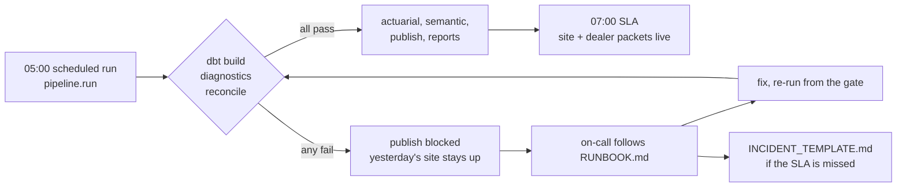

# Operating model: the data department in a box

How the platform is run day to day: what we promise, what to do when a check fails, how work comes
in and how changes ship. Every page here is owned by the Reporting Manager. A change to a promise
(an SLA, a threshold, a gate) goes through [RELEASE.md](RELEASE.md) like any code change.

| Page | Use it when |
|---|---|
| [SLA.md](SLA.md) | You need to know what "on time" and "correct" mean, and who is told when we miss |
| [RUNBOOK.md](RUNBOOK.md) | A pipeline step or a diagnostics / reconciliation gate failed |
| [INCIDENT_TEMPLATE.md](INCIDENT_TEMPLATE.md) | Something reached (or nearly reached) a stakeholder wrong or late |
| [postmortems/](postmortems/) | You want to see a finished postmortem (the stale product dimension) |
| [INTAKE_FORM.md](INTAKE_FORM.md) | Someone asks for a new report, metric, extract or fix |
| [DATA_DICTIONARY.md](DATA_DICTIONARY.md) | You need a table or column meaning (generated, do not hand-edit) |
| [RELEASE.md](RELEASE.md) | You are about to ship a model, report, seed or threshold change |

Live status of all of this is the **Operations** page of the report site (`site/ops.html`), built by
`reports/ops.py` from the `audit` schema on every run.

## The daily cycle

The gate rule is enforced in code, not by habit: `pipeline/run.py` refuses to run actuarial,
semantic, publish or reports unless the last dbt, diagnostics and reconcile results were ok
(`data/runs/_gates.json`). A failed day therefore means *late*, never *wrong*.

## Roles (job titles, as in docs/V3_DESIGN.md)

| Role | In this operating model |
|---|---|
| Reporting Manager | Owns the SLAs, runbook, intake queue, release checklist and the report-site shell. Runs the monthly usage review |
| Data Engineering Manager | Owns the gates (dbt, diagnostics, reconcile) and the pipeline runner; primary on-call for steps 3-6 |
| Data Engineer | Owns sources, the landing feed and ingest; primary on-call for steps 1-3 |
| Senior Data Analysts, Financial Analysts | Own their domain marts and reports; peer-review each other's changes |
| Senior Power BI Specialist | Owns the semantic model and metric entries; signs off metric changes |
| Data Scientist | Owns actuarial outputs (IBNR, earning curves) |
| Director | Approves SLA changes and incident severity 1 communications |
